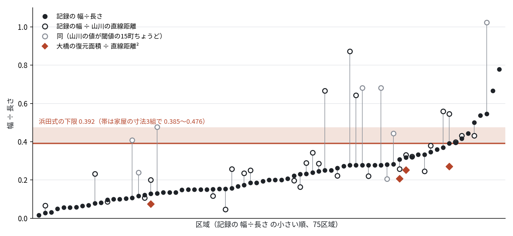

# 江戸の長い大火の記録された焼失区域は、検討した条件の浜田式の形より細い ——『東京市史稿』変災篇の寸法記録<!--n:n_areas-->75<!--/n-->区域と、地図で測られた直線距離による検討

> **11/5 18時: 再査読 MINOR（残る指摘は再現資料の公開URLだけ、review_paper_20261105.txt）。英訳 paper_en.md に着手。10/31 0時半: 査読（gpt-6.1-sol）MAJOR を受けて改訂。指標の再定義・15町の扱い・誤差の書き方・監査表の矛盾を直した版。10/30 18時半: <!--n:n_areas-->75<!--/n-->区域・<!--n:n_shapes-->363<!--/n-->件で数字を出し直した版。未査読（10/31 に査読に出す）。** 経過は plan_edo_fire_shape.md の10/30の項。

（原稿の下書き。2026-10-30 08:34 着手。主問は企画レビュー2回目（GO）で固定したもの。10/31 14:30 査読 MINOR、11/5 再査読 MINOR）

読者: 市街地火災の延焼予測を扱う人（火災学・都市防災）と、江戸の火災史を扱う人。

## 要旨

市街地火災の延焼範囲の予測に使われてきた浜田式（1951）は、風下・風横・風上の三方向の延焼速度から卵形の焼失区域を与える。この形が実際の大火の焼け跡と合うかを、江戸〜明治初めの記録で確かめた。

**方法。** 『東京市史稿』変災篇の全文から「長さ・幅」（「竪・横」を含む）の記録<!--n:n_shapes-->363<!--/n-->件を抽出し、長さ10町（約1.1 km）以上で一つの出火から続いて焼けた区域の寸法と読める<!--n:n_areas-->75<!--/n-->区域を、別系統のモデルによる盲検の読みと原本画像で監査した。浜田式から組んだ形の 平均幅÷長さ は、検討した条件（風速5〜30 m/s、4〜8時間、家屋の寸法3組）で 0.385 以上、既定の条件で 0.392 以上で、延焼時間を限りなく長くしても 0.378 を下回らない。

**結果。** 記録の 幅÷長さ は<!--n:n_areas-->75<!--/n-->区域の中央値 <!--n:all_med-->0.200<!--/n-->（ブートストラップ95%区間 <!--n:all_ci-->0.154〜0.250<!--/n-->）で、<!--n:all_below-->67<!--/n-->区域（<!--n:all_pct-->89<!--/n-->%）が 0.392 未満だった（符号検定 p <!--n:all_signp-->< 0.001<!--/n-->）。幅を「平均」と明記した<!--n:avg_n-->21<!--/n-->区域は中央値 <!--n:avg_med-->0.200<!--/n--> で<!--n:avg_below-->19<!--/n-->区域が未満、例外は文政12年の己丑火事（0.417）と長さ10町あまりの安政元年の火事（0.444）だった。

**長さの物差し。** 記録の「長さ」は直線より長めに書かれることがある。山川健次郎（1881）が地図で測った出火点から最遠点までの直線距離を、照合できた<!--n:ym_n-->38<!--/n-->区域について使った。この38区域だけで比べると、記録の 幅÷長さ は中央値 <!--n:rec38_med-->0.257<!--/n-->（<!--n:rec38_below-->34<!--/n-->区域が 0.392 未満）、記録の幅÷山川の直線は <!--n:ym_med-->0.287<!--/n-->（95%区間 <!--n:ym_ci-->0.239〜0.399<!--/n-->、<!--n:ym_below-->24<!--/n-->区域・<!--n:ym_pct-->63<!--/n-->%が未満、符号検定 p <!--n:ym_signp-->= 0.143<!--/n-->）で、物差しを直線に替えると細さは弱まる。ただし「記録の幅÷山川の直線」は浜田式の 面積÷全長² と同じ指標ではなく補助的な指標である。形の比較の中心には、記録の面積を 幅×記録の長さ と推定して直線の2乗で割った値を置く（同じ面積なら全長以下の直線で割るほど大きく出るが、推定面積の正確さは保証されない）。この中央値は <!--n:a38_med-->0.366<!--/n-->で、<!--n:a38_below-->20<!--/n-->区域が 0.392 未満にとどまる。直線を使った検証では、記録の比ほど明瞭な差を確認できない。山川の値は閾値の15町に積み上がっており、丸めの可能性がある。この値を除いた<!--n:ym15_n-->30<!--/n-->区域の探索的な感度分析では、記録の幅÷山川の直線は中央値 <!--n:ym15_med-->0.257<!--/n-->（<!--n:ym15_ci-->0.228〜0.343<!--/n-->、p <!--n:ym15_signp-->= 0.016<!--/n-->）、面積÷直線²は <!--n:a30_med-->0.334<!--/n--> だった。書かれた寸法を使わずに、大橋（2011）が地図に復元した5件の 面積÷直線² は 0.075〜0.272 で、すべて未満だった。山川との照合でみた記録の長さと直線のずれは、30区域で対数の標準偏差 <!--n:logk_sd-->0.49<!--/n--> だった。これは二資料間のずれであって、記録の長さの誤差の上限とは限らない。仮定した誤差モデルで記録の比0.200を長さで選ぶ偏りだけから出すには σ≈<!--n:sig_all_s-->1.0<!--/n--> が要り、照合例のずれ 0.49 より大きかった。

**結論。** 記録された長さと幅を使う限り、記録された長い大火の焼け跡は検討した条件の浜田式の卵形より横に狭い。この細さは、長さの物差しを山川の直線に替えると弱まり、面積÷直線²では記録の比ほど明瞭な差を確認できない。復元面積5件はすべて浜田式の比より小さいが、大橋が選んだ事例で無作為の標本ではない。「横」で書かれた元禄期の記録などに、浜田式より太い区域が少なからずあることにも注意が要る。

## 1. 序論

市街地火災の延焼範囲を予測する日本の標準的な道具は、浜田（1951）の延焼速度式と、そこから導かれる卵形の焼失区域である。風下・風横・風上の三方向の速さを与えると、焼失区域は風下と風上の二つの半楕円を貼り合わせた形になり、その面積と周長は都市等級要綱に採り入れられて全国の自治体で使われてきた（堀内）。現在の被害想定でも、放水開始までの火面周長の算定に同じ楕円が使われている（堺市の被害想定、東京消防庁2001式）。

この形が、実際の大火の焼け跡の形と合っているかを量として確かめた研究は少ない。浜田式の検証は主に風下の速さ（何 m/h で燃え進んだか）について行われ、酒田大火（1976）への試算では浜田式が実際の延焼速度の約1.4倍だった（堀内）。横の広がりについては、Himoto & Tanaka（2008）が酒田大火の再現計算で横方向を過大に見積もることを報告し、放水が火の横から行われたことを理由に挙げている。室﨑（2020）は、酒田で21時ごろに風下での防御をあきらめ「風横から挟み撃ち」に切り替えたことを記している。しかし多数の火災について形を測り、浜田式の予測と並べた例は見当たらない。

林野火災では、焼失区域を楕円とみなして長さ÷幅を風速の関数として与える枠組みがある（Alexander 1985: L/B = 1.0 + 0.00120 W^2.154、W は10 m 高の風速 km/h）。市街地では、こうした形の経験則が実測から組まれていない。

江戸〜明治初めの記録には、焼失区域を「長さ何町、幅平均何町」と書いたものが多く残る。『東京市史稿』変災篇はそれらを原文のまま集めている。本稿はこの記録から長い単独の大火を選び、原本の画像で一件ずつ監査したうえで、平均幅÷長さを浜田式・藤田の半楕円モデルの予測と比べる。

**主問**: 全体の寸法と判定した江戸の長い単独火災の平均幅÷長さは、指定条件（風速5〜30 m/s、4〜8時間）の浜田式の予測（0.392以上）より小さいか。

## 2. 方法

### 2.1 浜田式から形を組む

（hamada_shape.py。仮定 P1〜P4 を明記し、テスト付き）

- 風下の到達距離 S1、風横 S2、風上 S3 を浜田式の三方向の速さから時間 t で求める（藤田1975の形）
- 焼失区域を (S1, S2) と (S3, S2) の二つの半楕円とみなす。面積 A = (π/2)·S2·(S1+S3)、長さ L = S1+S3
- 平均幅÷長さ = A/L² = (π/2)·S2/(S1+S3)

予測（時間の係数を風下だけにかける P2）:

| 風速 m/s | 4時間 | 6時間 | 8時間 |
|---|---|---|---|
| 5 | 0.467 | 0.462 | 0.459 |
| 10 | 0.412 | 0.407 | 0.404 |
| 15 | 0.400 | 0.395 | 0.392 |
| 20 | 0.405 | 0.400 | 0.397 |
| 30 | 0.428 | 0.422 | 0.419 |

風速5〜30 m/s・4〜8時間の範囲を格子（251×81点）で探して得た最小値は 15.3 m/s・8時間の 0.3922（主問の基準 R0 = 0.392。格子上の最小で、厳密な下限ではない）。時間の係数を全方向にかける変種（P2'）では 0.56〜0.62 とさらに太い。家の幅・隣棟間隔（a, b）を既定値（8 m・4 m）から (8, 2)・(10, 6) に変えた2組を含む3組で、風速5〜30 m/s・4〜8時間の値は 0.385〜0.476（最小は (10, 6) の 0.385。付録A）。風向が時間とともに75度回ると、凸包で 0.55 まで太る（hamada_veer.py）。ここで試した変種では、予測は 0.38 を下回らなかった（0.37 は余裕をみた基準として表に使う）。延焼時間を長くしても比は下がり続けない。風下の速さが1.6倍に加速したあとは三方向の速さの比で形が決まり、時間を限りなく長くした極限は既定の家屋寸法で 0.385、3組で 0.378 以上になる（風速5〜30 m/s、hamada_shape.py の mean_width_ratio を t → 10⁷ 分で計算）。12時間で 0.390、36時間で 0.386。長く燃えた火事ほど細いことは、浜田式の中では説明にならない。

### 2.2 記録から寸法を拾う

- 資料: 『東京市史稿』変災篇 第4・第5（国立国会図書館デジタルコレクション pid 1915668・1915694）。次世代デジタルライブラリーの OCR 全文（第4巻604コマ・第5巻737コマ）から「長…幅…」と「幅…長…」の二つの型を正規表現で拾い（hensai_shapes.py。OCR が「凡」を異体字「凢」で読んだ箇所、「幅廣狹平均して」「幅平均ニして」などの言い回し、長さの側に「平均」が付く「長サ平均」、幅の単位の「里」、幅を「横・橫・濶・巾」・長さを「竪・縱」と書く型、数の「卅」、「幅平均凡」も拾う）、重複を除いて363件
- 単位: 1町 = 60間、1間 ≈ 1.82 m。「三四町」のような幅のある数は中央の値、「半」は 0.5、同じ単位の二つの数は平均
- 「幅平均」の意味: 明治の区役所の附箋（第5 コマ525）が長延×幅平均で坪数を出しており、ここでは幅平均が面積÷長さとして使われている。江戸期にも、文政12年の大火のあとの比較（変災篇第5 コマ213、甲子夜話続編などの引用）が「寅年三月四日芝田町〓出火、長二里半。幅七町。此坪數二百二十六萬八千坪」「丑年三月二十一日神田佐久間町〓出火、長壹里。幅二拾町。此坪數二百五十九萬二千坪」と、長さ×幅をそのまま坪数にしている（5400間×420間＝226万8000坪、2160間×1200間＝259万2000坪で一致）。この書き手にとって幅は 面積÷長さ だった。「平均」と書かない幅でもこの意味で使われた例があることになる。ただし、どの記録の幅もこの意味だと確かめたわけではない。この解釈のもとで記録の 幅平均÷長さ は A/L² に当たり、2.1 の量と比べられる。解釈への依存を見るため、結果では「平均」と明記された区域を別に示す
- 長さの意味: 山川健次郎（1881）が地図で測った「焼失直距離」（出火場所から焼失範囲の最遠点までの直線、大橋 2011 の付録1に89件）と比べると、照合できた<!--n:ym_n-->38<!--/n-->区域で 記録の長さ÷直線 は中央値<!--n:k_med-->1.30<!--/n-->（15町ちょうどの値を除く<!--n:ym15_n-->30<!--/n-->区域で<!--n:k15_med-->1.06<!--/n-->、log の標準偏差<!--n:logk_sd-->0.49<!--/n-->）（straight_check/match_yamakawa.py）。記録の長さは直線より長めで、両端が0.6 kmしか離れていないのに長さ23町と書かれた例（天明5年の横山町）もある

### 2.3 長い区域の選定と監査

- **母集団**: 変災篇 第4（604コマ）・第5（737コマ）の全文（ndl_fulltext.py dump）から 2.2 の型で拾った<!--n:n_shapes-->363<!--/n-->件のうち、長さ600間（10町）以上の<!--n:n_cand-->118<!--/n-->件を候補とした。型で拾えなかった記録（手で読んだ<!--n:n_outside_hand-->14<!--/n-->件と、月堂見聞集の誤った数に代えた萬年記の1件）の計<!--n:n_outside-->15<!--/n-->件を足し、監査したのは<!--n:n_audited-->133<!--/n-->件。候補のうち<!--n:n_excl-->41<!--/n-->件を外し（安政2年10月2日の地震の夜の同時多発の火事<!--n:ex_quake-->13<!--/n-->、区域の一部だけの寸法<!--n:ex_part-->9<!--/n-->、複数の火事・出火の合計<!--n:ex_sum-->6<!--/n-->、同じ火事の別の記録<!--n:ex_dup-->6<!--/n-->、火事の途中の規模<!--n:ex_mid-->3<!--/n-->、焼け跡の寸法でないか数が読めないもの<!--n:ex_other-->4<!--/n-->）、候補<!--n:n_cand-->118<!--/n-->件の残り<!--n:n_adopt_ext-->77<!--/n-->件を採った。これに型の外から足した記録を合わせた<!--n:n_records-->92<!--/n-->記録を区域ごとに一つの代表に畳んで<!--n:n_areas-->75<!--/n-->区域になる。外した記録と理由は exclusions.csv（exclusions.py）
- **解析の単位**: 一つの出火から続いて焼けた区域。飛び火で離れた場所に始まった焼け跡は別の区域として数える。同時多発の地震の夜の区域（安政2年10月2日）は、一つの区域に何か所の出火が入るか分からないので主解析から外した
- **盲検の読み**: 候補ごとに、OCR 本文（対象の寸法の前500字・後80字）と寸法の語句だけを別系統のモデル（codex）に渡し、全体の寸法か部分・合計か、寸法の換算、「延」「平均」の有無、同じ火事の風と時刻を答えさせた。こちらの採否と換算値は見せていない（codex_check*/）。監査した<!--n:n_audited-->133<!--/n-->件のうち<!--n:n_blind-->129<!--/n-->件を盲検にかけた（<!--n:n_blind_opus-->26<!--/n-->件は Claude Opus にも）。かけなかった<!--n:n_blind_none-->4<!--/n-->件は、代表を別の記録にした同じ火事の綱文など3件と、地震の夜の江戸全体の焼失を幅2町の帯に換算した長さ1件で、全体か部分かの判断が要らない。残る<!--n:nocomp_dup-->3<!--/n-->＋<!--n:nocomp_other-->4<!--/n-->件は同じ火事の別記録か、焼け跡の寸法でない・数が読めないとして外したもので、全体か部分かは問題にならない。全体か部分かを最終の扱いと比べられた<!--n:n_blind_comp-->122<!--/n-->件のうち、codex の読みと食い違ったのは<!--n:n_blind_dis-->13<!--/n-->件: codex が大きな火事の一部と読んだが本稿の単位（一つの出火から続いて焼けた範囲）で採ったもの<!--n:dis_unit-->10<!--/n-->（飛び火区域を別に書く本火<!--n:dis_main-->6<!--/n-->、飛び火区域<!--n:dis_ember-->3<!--/n-->、同じ日の別の出火<!--n:dis_separate-->1<!--/n-->＝宝暦10年2月6日 芝神明前、綱文が別の火事として書く）、codex は全体と読んだが別々の出火の合計として外したもの<!--n:dis_sum-->2<!--/n-->（明和9年の大火）、火事の途中の書付として外したもの<!--n:dis_mid-->1<!--/n-->（blind_coverage.py）。最後に見つけた取りこぼし8件（数の「卅」・幅の「巾」）は、同じ問いを Claude Opus と codex の両方に答えさせ、全体か部分か・換算値・「平均」の有無がすべて一致した（codex_check_kin/、compare_blind.py）
- **原本画像での監査**: 候補すべてを国立国会図書館の画像で読み、元号・日付・出火地・焼け止まり・「幅平均」の有無・長さが「延」か・全体か部分かを決めた（codex_check_full/audit.csv、edo_long_fires_13.csv の audit 列）。外したのは、町ごとの部分の寸法、複数の出火の合計（明和9年の大火など）、火事の途中で書かれた書付、広小路などの寸法
- **火事の年月日**: 変災篇の節の見出し（「N、M月D日火災」）で決めた。本文中の「○寛政十二年」のような注は、引用した史料の側の年を編者が付けたもので、火事の年と1年ずれることがある（例: 享保2年12月28日の牛込の火事に月堂見聞集の「享保三年」、寛政11年3月10日の麻布古川の火事に歴代炎上鑑の「寛政十二年」）
- **同じ区域の複数の記録**: 代表は、幅を「平均」と明記した記録、なければ 幅÷長さ が大きい方（仮説に不利な側）。月堂見聞集の享保3年5月1日の「長百二三十町」は中橋から築地までの距離と合わないので、同じ見開きの萬年記「凡及三十餘町、但横三四町歟」を採った
- **幅が範囲で書かれた記録**: 「幅所により五町三町」「廣狹は所に依て十町十五町程の不同」のように幅が所によって違うと書かれた記録は、書かれた最小と最大の中間を幅とした（3区域）
- **面積を帯に換算した書き方**: 江戸の記録には、焼けた面積を幅1町（または2町）の帯の長さに換算して書く慣行がある（天和2年の大火「横はゞ一丁にしてたての長さ十三里八丁」第4巻233、享保6年春の六度の火事の合計「燒跡橫幅一町ニ長サ八十九里十三町」「幅貳町ニ積り、長サ貳拾壹里」第4巻389）。幅が1町・2町ちょうどで長さが何里にもなるこの型は焼け跡の形ではないので外した。「凡幅卅町ニ長サ三里餘積也」のような「積」は見積もりの意で、換算ではない
- **結果**: <!--n:n_records-->92<!--/n-->記録・<!--n:n_areas-->75<!--/n-->区域（edo_long_fires_v2.csv、build_long_fires_v2.py が監査表から作る）。うち飛び火区域3、幅「平均」明記<!--n:avg_n-->21<!--/n-->
- **抽出の点検**: 正規表現の取りこぼし（幅を先に書く型、異体字「凢」、幅の言い回し、「長サ平均」、幅の単位「里」、幅を「横・濶・巾」・長さを「竪・縱」と書く型、「長…。幅…」と句点で区切る型、数の「卅」）は、見つけるたびに直して全文から抜き直した。抽出の元が全文でなく検索語の前後だけの抜粋だった時期があり（第4巻は604コマ中9コマ）、全文に替えて候補が36件増えた。正規表現の型にはまらない書き方（長さの語と数のあいだに地名が挟まる「長サ靑山ヨリ品川マテ一里半」、長さの語が無い「凡幅六町半に廿三町程」、割注が本文に混ざって OCR が崩れたもの）は、山川の表にあって台帳と照合できない長い火事の節を当たり（straight_check/yamakawa_unmatched_scan.py）、本文と画像で手で読んで足した（build_long_fires_v2.py の MANUAL、出所「手で読んだ記録」）。付表の出所の列で「手で読んだ記録」とした<!--n:n_manual-->15<!--/n-->記録（<!--n:n_manual_areas-->14<!--/n-->区域。<!--n:n_outside_hand-->14<!--/n-->記録は型の外、1記録＝享保12年12月6日 麹町は型で拾っていたが採否の記録が無く、11/5 に見つけて手で監査した）も、画像で読んだ字と OCR の前後を codex と Claude Opus に別々に渡す盲検にかけ、全体の寸法か・長さと幅の換算・「平均」の有無が3者で一致した（codex_check_manual/。11/5 に足した享保12年12月6日 麹町は codex_check_unaudited/）
- **長さの物差しの照合**: 記録の長さを、山川健次郎（1881）の焼失直距離（大橋 2011 付録1）と和暦の年月日で突き合わせた（straight_check/match_yamakawa.py）

## 3. 結果

### 3.1 主解析

<!--n:n_areas-->75<!--/n-->区域（edo_long_fires_v2.csv）の 幅÷長さ。区域に複数の記録があるときの代表は 2.3 の規則による。

| 数え方 | 区域数 | 中央値 | 0.392 未満 | 0.37 未満 | 0.499 未満 |
|---|---|---|---|---|---|
| 幅に「平均」と明記の区域だけ | 21 | 0.200 | 19 | 18 | 21 |
| 全75区域 | 75 | 0.200 | 67 | 65 | 70 |
| 飛び火区域を除く（本火だけ） | 72 | 0.197 | 65 | 63 | 68 |
| 長さが「延」の記録を除く | 70 | 0.190 | 62 | 60 | 65 |
| 「平均」と書かれていない区域 | 54 | 0.197 | 48 | 47 | 49 |
| （参考）地震の夜の4区域も入れる | 79 | 0.200 | 70 | — | — |
| （参考）同、「平均」明記だけ | 25 | 0.222 | 22 | — | — |

中央値のブートストラップ95%区間は、全区域 <!--n:all_ci-->0.154〜0.250<!--/n-->、「平均」明記の区域 <!--n:avg_ci-->0.136〜0.318<!--/n--> で、どちらも 0.392 を含まない（中央値が 0.392 だとする符号検定で、全区域 p <!--n:all_signp-->< 0.001<!--/n-->、「平均」明記 p <!--n:avg_signp-->< 0.001<!--/n-->）。これは区域を独立な標本とみなした区間である。同じ時代の記録は書き方が似るので、10年ごとの年代（<!--n:n_decades-->17<!--/n-->のまとまり）を丸ごと引き直すと、全区域の区間は <!--n:all_cci-->0.154〜0.268<!--/n--> に広がるが、0.392 は含まない。

0.392 を超えるのは<!--n:over_n-->8<!--/n-->区域。元禄16年11月18日の四谷伊賀町からの火事（「火本より燒留迄長サ貳里餘、横五十六町程」0.778、京への書付、火が三口に分かれた）、弘化3年の丸山火事の駿河台への飛び火区域（「幅壹里程、長サ壹里半」0.667、火先が二口に分かれて鉄砲洲と本材木町で焼け止まった区域で、「幅」は二つの火先の外形とみられる）、元禄12年4月4日の日本橋釘店からの火事（「橫十五町長サ廿七八丁」0.545）、文化8年12月11日（「長サ十三町ニ、幅七町計」0.538）、元禄11年9月6日の勅額火事（京の日記の伝聞「竪二里許、横一里餘」0.500）、安政元年（続武江年表「長十町三十間餘、町幅平均まして四町四十間程」0.444、綱文も同じ寸法）、文政12年3月21日の己丑火事（町奉行所の申し渡し「凡長一里餘幅平均拾五丁程」0.417、幅を平均と明記した<!--n:avg_n-->21<!--/n-->区域の中の例外は安政元年とこの火事の二つ）、享保6年3月3日の三河町からの火事（天享吾妻鑑「大法竪三十八町程、横十五町程」0.395）。8区域のうち5区域は元禄期の記録か「横」で書かれた記録で、2区域は長さ10〜13町の短い火事である。地震の夜の記録では、新吉原・浅草の一帯（第5巻423、「長凡拾五丁餘、幅平均七丁半」0.500）が 0.392 を超える。

幅を「横」と書いた記録（<!--n:yoko_n-->20<!--/n-->件）は中央値 <!--n:yoko_med-->0.264<!--/n--> で、「幅」「巾」と書いた記録（<!--n:haba_n-->72<!--/n-->件）の <!--n:haba_med-->0.162<!--/n--> より太い。ただし同じ区域に両方がある2区域では近く（享保10年の青山 横0.161・幅0.185、己丑火事 横0.500・幅0.556）、「横」の記録は元禄〜享保初めに偏っている。時代で分けると、1719年まで<!--n:era1_n-->26<!--/n-->区域 中央値<!--n:era1_med-->0.223<!--/n-->、1720〜1799年<!--n:era2_n-->26<!--/n-->区域 <!--n:era2_med-->0.153<!--/n-->、1800年以降<!--n:era3_n-->23<!--/n-->区域 <!--n:era3_med-->0.231<!--/n--> で、語の違いと時代の違いは件数が少なく分けられない

出典の種類で分けると（source_tags.csv、記録の直後の出典名を拾い、拾えない17区域は本文を読んで付けた）:

| 出典の種類 | 区域数 | 中央値 | 0.392 未満 |
|---|---|---|---|
| 京の公家日記（基熙公記・基量卿記・兼香公記。江戸滞在中の基熙公記の1区域のほかは江戸から届いた伝聞） | 6 | 0.310 | 4 |
| 公的な書上・届・申渡・記録（町年寄手控・柳営日次記・御徒方萬年記・火事場見廻の書上・編者の綱文など） | 19 | 0.200 | 17 |
| 年表・炎上鑑（年代炎上鑑・天享吾妻鑑・続武江年表など） | 24 | 0.211 | 21 |
| 月堂見聞集 | 16 | 0.162 | 16 |
| その他の日記・随筆 | 10 | 0.145 | 9 |

公的な記録（<!--n:kou_med-->0.200<!--/n-->）と年表（<!--n:nen_med-->0.211<!--/n-->）は同じで、月堂見聞集とその他の日記（0.15〜0.16）が細く、京の伝聞が太い。細さの一部は、伝聞や見聞集の書き方による可能性がある。ただし公的な記録でも<!--n:kou_n-->19<!--/n-->区域中<!--n:kou_below-->17<!--/n-->区域が下限より細い。公家日記の<!--n:kuge_n-->6<!--/n-->区域を除くと<!--n:nokuge_n-->69<!--/n-->区域で中央値 <!--n:nokuge_med-->0.185<!--/n-->、<!--n:nokuge_below-->63<!--/n-->区域が下限未満。出典の種類を一つずつ除いても、中央値は <!--n:loo_med_min-->0.185<!--/n-->〜<!--n:loo_med_max-->0.222<!--/n-->、95%区間の上端は最大 <!--n:loo_ci_max-->0.273<!--/n-->（符号検定 p <!--n:loo_p_max-->< 0.001<!--/n-->）で、どれか一つの出典が細さを作っているのではない。

幅を平均と明記した区域と、そうでない区域の中央値は <!--n:avg_med-->0.200<!--/n--> と <!--n:noavg_med-->0.197<!--/n--> である。「平均」と書かれない幅は最大の幅である可能性がある。最大幅÷長さで比べるなら浜田式の側は 2·S2/(S1+S3) で、下限は (4/π)×0.3922 = 0.499。平均と書かれない<!--n:noavg_n-->54<!--/n-->区域のうち<!--n:noavg_499-->49<!--/n-->区域がこれより細い。ただし、「平均」と書かれない幅が本当に最大の幅かは決められない。「平均」の明記も、その幅が面積÷長さで出されたことまでは保証しない（2.2）。

### 3.2 記録の誤差と、長さで選ぶことの偏り

誤差は中央値ゼロなので、それだけでは比の中央値は動かない。動くのは、記録の長さで「10町以上」を選ぶときで、長さを大きく書かれた火事ほど選ばれやすく、分母が大きく出る。これを模擬計算で見積もった（error_sim.py、テスト付き）。

- 本当の形はすべて R0 = 0.392 とする
- 本当の長さは対数正規で、記録 363 件の log 長さの平均（5.65）と分散（標準偏差 1.67）から、誤差の分散 σ² を引いたもの
- 記録の長さと幅に、それぞれ独立に対数で σ の誤差を掛ける
- 記録の長さが 600 間以上のものを選び、記録の 幅÷長さ の中央値を見る（各 2000 件 × 200 回の中央値）

| σ | 0.15 | 0.2 | 0.4 | 0.6 | 0.7 | 0.8 | 0.9 | 1.0 |
|---|---|---|---|---|---|---|---|---|
| 見かけの中央値 | 0.386 | 0.381 | 0.352 | 0.309 | 0.283 | 0.258 | 0.230 | 0.202 |

<!--n:n_areas-->75<!--/n-->区域の記録の比の中央値 <!--n:all_med-->0.200<!--/n--> をこの偏りだけで出すには σ ≈ <!--n:sig_all_s-->1.0<!--/n-->（一つの記録の長さが本当の長さの2倍を超えるか半分を切る確率 <!--n:p_all-->49<!--/n-->%）が要る。この計算は「誤差を含む記録の長さで選び、記録の幅÷長さを計算する」過程の出力だけを記録の比0.200に当てたもので、直線基準の比（山川の距離で割った値）に必要な σ を与えるものではない。直線基準についてはこの模擬計算を行っていない。山川側の収録条件・距離の誤差・照合対象の選択を組み込んでいないためである。

二資料の長さのずれは、山川（1881）が地図で測った焼失直距離との照合で見える。15町ちょうどの値を除いて照合できた<!--n:ym15_n-->30<!--/n-->区域で log(記録の長さ÷直線) の標準偏差は <!--n:logk_sd-->0.49<!--/n--> だった。これは照合できた30区域における二資料間のずれであり、長さの誤差の上限とは扱わない。照合できる火事への選択、15町の値の除外、両資料の誤差の相関によって、全対象の誤差より小さく出ている可能性がある。この値には記録の誤差のほかに「道なりか直線か」の測り方の違いも入る。幅にも同じ σ = <!--n:logk_sd-->0.49<!--/n--> の独立な誤差を置くと、見かけの中央値は <!--n:sim_sd-->0.334<!--/n--> までしか下がらず、記録の比 <!--n:all_med-->0.200<!--/n--> に届かない。仮定した誤差モデルでは、必要な σ が照合例のずれより大きかった、という範囲の結論である。幅の誤差の大きさは直接は測れていない。天保9年（第5巻319）は「幅平均九丁程」が大橋（2011）の復元面積から出る平均幅の約2倍で、幅を広く書く例がある。幅を広く書く誤差は比を太らせる向きに効く。

同じ火事の二つの記録（459・461）は長さが 1.95倍、幅が 2.4倍違うが、比は 0.10 と 0.13 で近い。長さと幅の誤差が正に相関するほど比の偏りは小さくなるので、独立の誤差を置いた上の計算は偏りを大きめに見積もる側にある。

### 3.3 長さの物差しを替えた検証: 山川の直線距離と、復元された面積

記録の「長さ」が出火点から焼け止まりまでの直線でなく、道なりの延べや丸めた数なら、比は小さく出る。そこで書き手の違う二つの物差しで測り直した。

**山川の焼失直距離。** 山川健次郎（1881）「東京府下火災録」は、明暦3年から明治14年までの「長サ十五町以上ニ達スル」大火93件について、長さを「東京圖ニ於テ火元ヨリ一直線ヲ引キテ、燒亡區域中最遠ナル燒留リノ點ニ至ル」直線で測っている（変災篇第5 コマ599 の引用。表は大橋 2011 の付録1に89件）。和暦の年月日で突き合わせ、飛び火区域・飛び火区域を別に持つ火事の本火（明石屋火事・丸山火事）・山川の距離が別の出火まで含む延享3年と享保16年4月15日（目白台の火は市谷田町で止まり3km弱だが、山川の60町は同じ日の麹町→芝の火事と一つにした距離とみられる）を除いて、<!--n:ym_n-->38<!--/n-->区域が比べられた（straight_check/match_yamakawa.py）。

| 物差し | 区域数 | 中央値 | 0.392 未満 |
|---|---|---|---|
| 記録の 幅÷長さ（3.1、全区域） | 75 | 0.200 | 67 |
| 同、山川と照合できた区域だけ | 38 | 0.257 | 34 |
| 記録の幅 ÷ 山川の直線 | 38 | 0.287 | 24 |
| 記録の面積（幅×記録の長さ）÷ 山川の直線² | 38 | 0.366 | 20 |
| （探索的）15町ちょうどの値を除く30区域: 記録の比 | 30 | 0.248 | 27 |
| 同、記録の幅 ÷ 山川の直線 | 30 | 0.257 | 22 |
| 同、記録の面積 ÷ 山川の直線² | 30 | 0.334 | 19 |

物差しの効果は、全<!--n:n_areas-->75<!--/n-->区域との比較でなく、照合できた同じ38区域で見る。記録の比 0.257 は、記録の幅÷山川の直線で 0.287 に上がる。ただし記録の幅÷山川の直線は浜田式の 面積÷全長² と同じ指標ではないので、補助的な指標とする。形の比較の中心には、記録の面積を 幅×記録の長さ と推定して直線の2乗で割った「面積÷直線²」を置く。同じ面積 A を用いるなら、直線 D が全長 L 以下のとき A/D² ≧ A/L² になるが、記録から推定した面積 A の正確さは保証されない。この量は記録の長さ（山川の直線より中央値で<!--n:k_med-->1.30<!--/n-->倍長い）に依存するため、中央値は 0.366 まで上がる。記録の長さを信じるかどうかで結論が変わる。

記録の長さ÷山川の直線は中央値<!--n:k_med-->1.30<!--/n-->（四分位<!--n:k_q1-->0.88<!--/n-->〜<!--n:k_q3-->2.00<!--/n-->）で、記録の長さは長めに書かれている。照合できた同じ<!--n:ym_n-->38<!--/n-->区域では、記録の比の中央値が <!--n:rec38_med-->0.257<!--/n-->、補助指標の幅÷直線の中央値が <!--n:ym_med-->0.287<!--/n--> で、補助指標が 0.392 を超える区域がある（<!--n:ym_over_list-->元禄12年4月4日 日本橋釘店 1.02（山川15町）、元禄11年12月10日 本石町 0.87、宝永3年1月14日 須田町 0.68（山川15町）、正徳元年1月4日 芝土器町 0.68（山川15町）、享保2年12月28日 牛込天龍寺前 0.67、元禄16年11月29日 水戸様火事 0.64、元禄10年10月17日 小石川→芝 0.56、天保9年4月17日 0.55、享保8年2月16日 赤坂伝馬町 0.48（山川15町）、享保6年1月8日 呉服町 0.44（山川15町）、元禄11年9月6日 勅額火事 0.43、文政12年3月21日 己丑火事 0.43、正徳5〜6年 鍛冶橋・京橋（コマ326） 0.41（山川15町）、享保6年3月3日 三河町 0.40<!--/n-->）。それでも<!--n:ym_below-->24<!--/n-->区域（<!--n:ym_pct-->63<!--/n-->%）は、補助指標が数値上 0.392 未満だった。山川の表は89件中13件がちょうど15町（大火の定義の閾値、山川自身が「長サ十五町以上ニ達スル」火災を表に載せたと書く）に積み上がっている。この集中は、15町が下限の値または丸めである可能性を示すが、残る値すべてが下限だと確定する根拠にはならない。大橋が地図で測り直した2件（No.78・85）はどちらも15町（1.6 km）より長い1.8 km・1.7 kmだった。この2件は照合にその距離を使った（straight_check/match_yamakawa.py）。他の15町の実際の長さは不明である。探索的な感度分析として、残りの15町の値を除くと、<!--n:ym15_n-->30<!--/n-->区域で中央値 <!--n:ym15_med-->0.257<!--/n-->、<!--n:ym15_below-->22<!--/n-->区域（<!--n:ym15_pct-->73<!--/n-->%）が 0.392 未満、記録の長さ÷直線の中央値は<!--n:k15_med-->1.06<!--/n-->になる。

中央値の95%区間は、<!--n:ym_n-->38<!--/n-->区域で <!--n:ym_ci-->0.239〜0.399<!--/n-->（符号検定 p <!--n:ym_signp-->= 0.143<!--/n-->）と下限 0.392 にかかり、15町の値を除く<!--n:ym15_n-->30<!--/n-->区域では <!--n:ym15_ci-->0.228〜0.343<!--/n-->（p <!--n:ym15_signp-->= 0.016<!--/n-->）。山川の15町ちょうどの値が下限である場合は（本当の距離は15町以上）、それで割った比は本当の比の上限になる。直線で 0.392 を超えた<!--n:ym_over_n-->14<!--/n-->区域のうち<!--n:ym_over_floor-->6<!--/n-->区域がこの値だった。これらが下限なら、<!--n:ym_n-->38<!--/n-->区域の中央値と区間は幅÷直線の値を大きめに見積もる側にあるが、15町の意味は確定していない。年代ごとに引き直すと、それぞれ <!--n:ym_cci-->0.222〜0.431<!--/n--> と <!--n:ym15_cci-->0.221〜0.379<!--/n--> になる。補助指標の検定結果は、15町に積み上がった山川の値の扱いで変わる。これは浜田式の形状比についての検証とは解釈しない。

参考として、出典が公的な記録（3.1）の区域だけを山川の直線で測ると、<!--n:kym_n-->10<!--/n-->区域で中央値 <!--n:kym_med-->0.240<!--/n-->、<!--n:kym_below-->8<!--/n-->区域が 0.392 未満だった。このうち天保9年と安政2年の小網町は、大橋が測り直した距離で測った。10区域は少なく、どの指標でも保守的になる組み合わせとは言えない。

**復元された面積。** 大橋（2011）は5件の焼失範囲を町の単位で地図に描き、面積と焼失直距離を測っている。浜田式の比は 面積÷全長² で、全長は出火点→最遠点の直線 D 以上なので、同じ面積なら 面積÷D² は 面積÷全長² 以上になる。大橋の面積復元そのものの不確実性は別に残る。これは書かれた幅も長さも使わない。

| 大橋の番号 | 火事 | 面積÷直線² | 記録の比 |
|---|---|---|---|
| 73 | 文政6年12月25日 麹町 | 0.220 | — |
| 78 | 天保9年4月17日 小田原町 | 0.272 | 0.391 |
| 85 | 安政2年3月1日 小網町（変災篇の見出しは2日） | 0.208 | 0.308 |
| 87 | 安政5年11月15日 神田相生町 | 0.253 | 0.318 |
| 88 | 安政6年2月22日 青山 | 0.075 | 0.128 |

5件とも 0.392 未満（straight_check/ohashi_area.py）。天保9年は記録の幅と直線（大橋の測り直し 1.8 km）では 0.545 になったが、面積からは 0.272 で、書かれた「幅平均九丁」が復元面積から出る平均幅の約2倍だった。5件は大橋が地図化のために選んだ事例で、無作為の標本ではない。

**図1** <!--n:n_areas-->75<!--/n-->区域の 幅÷長さ（記録の比の小さい順）。黒丸は記録の比、白抜きの丸は記録の幅を山川（1881）の直線距離で割った比（灰色は山川の値が閾値の15町ちょうどのもの）、縦線は同じ区域の二つを結ぶ。赤い菱形は大橋（2011）の復元面積÷直線距離²（5件のうち<!--n:n_areas-->75<!--/n-->区域に含まれる4件。文政6年の麹町は変災篇に長さ・幅の記録が見当たらず、<!--n:n_areas-->75<!--/n-->区域に入っていない）。赤線は浜田式の既定の下限 0.392、帯は家屋の寸法3組での範囲（fig_main_v2.py）。

三つの物差し（記録の長さと幅、山川の直線、復元面積）で、多数は浜田式の卵形より細い。大きさは物差しで変わり、記録の比がいちばん細く出る。直線を物差しにすると、元禄・享保初めの記録を中心に下限を超える区域が<!--n:ym_over_pct-->37<!--/n-->%になる。

### 3.4 記録の書き方の対照: 短い火事

「幅平均」という書き方そのものが、比を小さく出す慣行だった可能性を、同じ史料の短い火事で確かめる。抽出した363件のうち幅に「平均」と書かれた記録（128件）を長さで分けると:

| 長さ | 件数 | 中央値 | 0.392 以上 |
|---|---|---|---|
| 2町未満 | 33 | 0.446 | 22 |
| 2〜5町 | 39 | 0.333 | 19 |
| 5〜10町 | 24 | 0.342 | 7 |
| 10町以上 | 32 | 0.117 | 2 |

浜田式の形は出火から30〜60分（風速5〜20 m/s）で 0.46〜0.57 で、同じ「平均」という書き方でも、短い火事では浜田式と同じくらい太い記録が多い。ただし、この表は部分の寸法や重複を含む抽出のままで、短い火事の寸法は「一町」「半町」のような粗い数が多く、長さは燃えていた時間でもない。長い単独火災とは標本の作り方が違うので、この対照から記録の慣行の影響の大きさや、消火・町割りの寄与は識別できない。長さとともに比が下がる見かけ（比を分母の長さに対して見る効果）もあるので、この表から「長いほど細くなる」とは言わない（3.2 の誤差の議論と同じ理由）。

### 3.5 近代の大火との対照

比は焼失面積÷長さ²（江戸の 幅平均÷長さ と同じ量）。長さは風下方向の端から端（modern_fires_shape.csv）。

| 火災 | 長さ km | 面積 km² | 平均幅÷長さ | 長さの出典 | 面積の出典 |
|---|---|---|---|---|---|
| 糸魚川 2016 | 0.30 | 0.040 | 0.44 | 建築研究所の調査報告 第4章「南北方向に最大で約300m」 | 新潟県災害アーカイブ 約4万 m² |
| 酒田 1976 | 0.87 | 0.225 | 0.30 | 内閣府 災害教訓の継承に関する専門調査会報告書 図4-1 を縮尺棒で目測 | 同報告書 焼失区域 22.5 ha |
| 新潟 1955 | ≈1.05 | 0.258 | ≈0.23 | 町名からの目分量（±0.15 km） | 新潟地方気象台 7万8千坪 |
| 能代 1949 | ≈1.5 | 0.836 | ≈0.37 | 二次資料（Wikipedia「東西約1,500m」）、一次資料未確認 | 同 25万2千坪 |
| 函館 1934 | 4.3〜5.0 | 4.13 | 0.17〜0.22 | 函館大火説明図の等時線と燃え止まり | 函館大火史 125万坪 |

函館は地峡の両側の海で横が切られるので比較から外す。新潟・能代は目分量・二次資料で、補助的な比較にとどめる。

長さ 1 km 未満の糸魚川だけが浜田式の範囲に入る。

### 3.6 風の強さとの関係

同じ火事について本文に書かれた風を、対象の記述の前1800字と前のコマの末尾を渡して別系統のモデル（codex）に読ませ、強い（烈風・大風・風強など）・風あり（風向だけ）・書かれていない・無風の四つに分けた（codex_check_wind/、wind_vs_shape.py）。あとから台帳に足した14区域は同じ形の問い（make_wind_prompt.py）を Claude Opus と codex の両方に答えさせ、強さの判定はすべて一致した（codex_check_wind_add*/）。

| 風の記述 | 区域数 | 中央値 | 0.392 未満 |
|---|---|---|---|
| 強い | 45 | 0.200 | 39 |
| 風あり（強さの語なし） | 16 | 0.211 | 16 |
| 書かれていない | 14 | 0.150 | — |
| 無風 | 0 | — | — |

読んだ<!--n:wind_read-->75<!--/n-->区域のうち、風の書かれた<!--n:wind_n-->61<!--/n-->区域の<!--n:wind_strong-->45<!--/n-->区域が強い風で、無風と書かれた区域は一つもない。順位相関は ρ = <!--n:wind_rho-->+0.04<!--/n-->（並べ替え検定 p = <!--n:wind_p-->0.73<!--/n-->）。この標本の中では、風の強さと形の関係は見えない。長い大火のほとんどが強い風の中で起きているので、標本の中に風の弱い火事がほとんど無く、浜田式の「風が強いほど細い」をこの記録で確かめることはできない。

風を読む本文の範囲は結果を左右する。本文を対象の前500字に狭めると、同じコマの離れた所に「格別風烈」（己丑火事）や「南風烈」（勅額火事）と書かれた火事が「書かれていない」に入り、「強いほど細い」（ρ = −0.29、p = 0.025）という見かけの関係が出る（区域が60だった時点の集計）。広い本文で読むとこの関係は消える。

## 4. 議論

- 本稿が示したのは形の差の大きさで、その原因は確かめていない。以下は原因の候補と、本稿のデータで言える範囲
- 横の消火: 江戸の破壊消防（風の横の家を壊して止める）と、戦後の放水（酒田の挟み撃ち）は、どちらも横に効く消火である。火の向かう先（頭）は熱と飛び火で近寄れず、横は近寄れる。浜田式は消火のない延焼の経験式なので、横の消火が効けば形は予測より細くなる
- この機構の候補は先行研究（Himoto & Tanaka 2008、室﨑 2020、『火災消防研究』1940 の工兵隊の証言）に記述があり、本稿はそれを新しく示すものではない。本稿が加えるのは、形の差の大きさを多数の記録で量として示したこと
- どれくらいの横の消火で足りるか（主問の外の目安）: 火の横に、出火から t0 後に防火線を築き始め、線を風下へ速さ σ で延ばしていく模型（flank_wall_toy.py）。消火なしの比は模型の形で 0.303 で、浜田式の 0.39 とは基準が違うので、比そのものでなく「消火なしの何割まで細るか」で見る。比が半分（0.15）になるのは、延焼時間が着手の遅れの3.3倍なら σ ≈ 2 V1、5倍なら σ ≈ 1.5 V1（V1 は頭の速さ）。防火線を頭の1.5〜2倍の速さで風下へ延ばせれば、江戸の細さが出る。酒田は 21時に挟み撃ちへ切り替え、延焼停止 04:30 で T/t0 ≈ 3.3 に当たる。この模型は企画レビューで主問から外した別課題で、ここでは大きさの見当にだけ使う
- 林野火災の楕円との比較（見立て）: 記録の比の中央値 <!--n:all_med-->0.200<!--/n--> を楕円とみなすと L/B ≈ <!--n:alex_lb-->3.9<!--/n-->で、林野火災の経験則（Alexander 1985）では10 m 高の風速 約<!--n:alex_w-->10<!--/n--> m/s（中央値の95%区間で <!--n:alex_w_lo-->9<!--/n-->〜<!--n:alex_w_hi-->12<!--/n--> m/s）の形に当たる。浜田式は同じ10 m/s で 0.404〜0.412（4〜8時間、2.1）である。ただし風速の記録がある近代の大火（3.5）に同じ式を当てると、酒田（12.2 m/s）0.153、能代（15.5 m/s）0.099、新潟（21.7 m/s）0.051 で、観測の 0.30・0.37・0.23 よりずっと細い。浜田式（6時間）はどれも 0.40 前後で観測より太い。近代の市街地火災の焼け跡は二つの式のあいだにあり、江戸の記録の「烈風」が10 m/s を大きく超えていたなら、江戸の比も同じくあいだに入る。林野の式は燃料も消火も違う火事から組まれたもので、ここでは大きさの見当として並べるだけである
- 別の説明の候補: 町割り（細長い敷地・半割屋の側壁が横の延焼を遅らせる、室﨑2020）。消火と町割りの寄与は、本稿のデータでは識別できない。3.4 の短い火事の記録は標本の作り方が違うので、どちらかを支持する材料にはならない。二つを分けるには、消火の着手時刻が分かる火事で形を比べる必要がある
- 太く出た<!--n:over_n-->8<!--/n-->区域のうち5区域（元禄11年・12年・16年の三つ、享保6年の三河町、己丑火事の別記録を含む）は元禄期の伝聞や「横」の記録で、火が数口に分かれた火事が多い。「横」が風に直角の平均幅でなく、数口に分かれた焼け跡の外形の広がりを言っているなら、比は太く出る。2区域（文化8年・安政元年）は長さ10〜13町と選んだ中では短い。文化8年の幅は「計」で平均ではないが、安政元年は続武江年表が「町幅平均まして四町四十間」と平均を明記している。消火の着手の遅れに比べて延焼時間が短かったのか、幅が最大の幅なのかは、本稿のデータでは分けられない。丸山火事の飛び火区域は火先が二つに分かれた区域で、一つの卵形とは別の形である。己丑火事（文政12年）は平均明記で 0.417 と、浜田式の下限をわずかに超える。この火事の山川の直線距離（3.8 km）は記録の長さ（一里餘）とほぼ同じで、物差しを替えても 0.431 と太い
- 記録の「長さ」の意味: 記録の長さは山川の直線距離より中央値で<!--n:k_med-->1.30<!--/n-->倍長く（3.3）、一部は両端の距離よりずっと長い。書き手が焼けた町筋の延べや、聞いた道のりを書いた可能性がある。幅も同じ書き手が同じ流儀で書いたはずで、天保9年のように復元面積の2倍の幅を書いた例もある。記録の比（中央値<!--n:all_med-->0.200<!--/n-->）と直線基準の比（<!--n:ym15_med-->0.257<!--/n-->〜<!--n:ym_med-->0.287<!--/n-->）と復元面積の比（5件、0.075〜0.272）は大きさが違い、どれが本当の形に近いかは決められない。記録の比と復元面積では多数が浜田式より細い向きにそろうが、直線基準の38区域では統計的に明確でない
- 実務への含意: 現在の被害想定は楕円を放水開始までに限って使っており、本稿の結果がそこを直接変えるわけではない。言えるのは、「平均」明記<!--n:avg_n-->21<!--/n-->区域のうち<!--n:avg_below-->19<!--/n-->区域では、記録された長さを固定し、記録の幅を平均幅と解釈したとき、既定の浜田式の形で換算した面積が記録から出る面積より大きい、ということまで。これは実測面積に対する予測誤差の検証ではない。太い<!--n:over_n-->8<!--/n-->区域と幅が平均か分からない<!--n:noavg_n-->54<!--/n-->区域を含めると一律には言えない。長さそのものの予測が外れれば面積の誤差の向きは変わるので、焼失面積一般の過大予測は示していない

## 5. 留保

- 風速・延焼時間は各火事について確定していない。主問は「検討した風速（5〜30 m/s）・時間（4〜8時間）・パラメータの範囲での浜田式の値」との比較で、各火事に浜田式を当てはめた予測の失敗を示したものではない
- 選んだのは長さ10町以上の記録だけで、結果を江戸の大火全般には広げない
- 記録の寸法は目測で、測量ではない
- <!--n:n_areas-->75<!--/n-->区域でも件数は小さい。幅が平均か最大かは、明記された<!--n:avg_n-->21<!--/n-->区域以外では決められない。地震の夜の火事を外したのは単位の定義による判断で、入れた場合も 3.1 に示した。選定（長さ10町以上・全体の寸法）は目立つ火事に偏る
- 山川の直線距離との照合は<!--n:ym_n-->38<!--/n-->区域（15町ちょうどを除くと<!--n:ym15_n-->30<!--/n-->区域）で、飛び火区域や山川の距離が別の出火まで含む火事は比べられなかった。山川の距離は出火点から最遠点までで、焼け跡の全長（風上側を含む）より短い。記録の幅÷山川の直線は浜田式の 面積÷全長² と同じ指標でなく、その解釈は3.3の面積÷直線²と合わせて読む
- 復元面積の5件は大橋（2011）が地図化のために選んだ事例で、無作為の標本ではない
- 出典の種類で比の大きさが違う。月堂見聞集とその他の日記が細く、京の公家日記が太い。公的な記録（<!--n:kou_n-->19<!--/n-->区域）は中央値 <!--n:kou_med-->0.200<!--/n--> で全体と同じくらい。見聞集や日記が火事を細く書く傾向があるなら、それらを含む全体の中央値は細さを少し大きめに見せている
- 江戸の後期は、幕府が町の一部に瓦葺・土蔵造を命じた区画がある（享保13年の番町・麹町、元文元年の神田橋外・三河町・駿河台、元文4年の柳原、寛保2年の赤坂、延享3年の築地から浅草御門内まで、いずれも焼けた武家地に拝借金つきで瓦葺を命じている）。享保15年1月の下谷七軒町から小石川への火事では、先年瓦葺を命じた所が焼け残ったと目付が触れた書付が変災篇に残る。この種の規制は延焼を帯状に抑えて焼け跡を細くする側に働きうるが、本稿は規制の有無を区域ごとに分けて比べていない。時代別の中央値は、瓦葺令が相次いだ1728〜1746年を含む1720〜1799年が最も細い（<!--n:era2_med-->0.153<!--/n-->）が、1800年以降は戻る（<!--n:era3_med-->0.231<!--/n-->）ので、規制の効果として読める形にはなっていない。浜田式の前提（木造の密集市街）との差の一部がここにあるかもしれない
- 再現資料の所在: https://github.com/tomo3141592653/edo-fire-shape （コミット 27b28c58ac。NDL の全文テキストの取得は2026年10月、集計は11月5日まで。11/5 に監査漏れ1件の追加と再集計）。`run_all.sh` が抽出と監査の判定から台帳を作り直し、本文の数と表をすべて埋め、本文は変わらない。資料の対応は 抽出<!--n:n_shapes-->363<!--/n-->件（hensai_shapes.csv）→ 長さ10町以上の候補<!--n:n_cand-->118<!--/n-->件 → 除外<!--n:n_excl-->41<!--/n-->件（exclusions.csv、理由と分類つき）・採用<!--n:n_adopt_ext-->77<!--/n-->件 → 型の外から足した<!--n:n_outside-->15<!--/n-->件と合わせて<!--n:n_records-->92<!--/n-->記録（edo_long_fires_v2.csv）→ 一区域一記録に畳んだ<!--n:n_areas-->75<!--/n-->区域。手で読み足した記録は付表の出所の列「手で読んだ記録」で追える。投稿時に公開URL・コミット・取得日を確定する
- 付表の宝暦10年2月6日では、第4巻500コマに二つの記録（明石屋火事本火の旧台帳の読み「幅十町程、長三十五丁三十五間」と、芝神明前の「長十三丁幅二丁」）がある。コマ番号だけでは記録を指せないので、記録の文言で区別した。採否は付表の「代表」「別記録」の列が最終で、除外の記録は監査CSVに分けてある
- 抽出の正規表現は、取りこぼしを見つけるたびに直してきた。まだ拾えていない書き方が残っている可能性がある
- Himoto & Tanaka 2003 と Himoto ほか 2008（どちらも IAFSS）は形を扱っていないことを確かめた（2008 は京都東山の消火なしの計算で、面積を円で近似）。森下雄治の博士論文（立命館 2014、江戸の火災脆弱性と防火施策を地図情報化で評価したもの。題と要旨からは焼け跡の形を扱っていないが、本文は国会図書館では館内限定、立命館のリポジトリはメンテナンス中で未確認）、消防研究所1977の酒田報告（NDL 非公開）は未確認で、既出の可能性が残る。樋本『Large Outdoor Fire Dynamics』（2023）は目次と紹介文が物理モデルと延焼計算の枠組みで、実火災の形の検証の章は無いが、本文は読んでいない

## 参考文献

（書きかけ。題は check_article_refs.py で照合してから確定）

- 浜田稔 (1951) 火災の延焼速度について. 1:35–44（原典は未見。藤田1975 は誌名を『火災の研究』、Himoto ほか 2008 IAFSS は Disaster Research, Non-life Insurance Rating Organization of Japan と書き、誌名が食い違う。原典で確かめる）
- 藤田隆史 (1975) 大震火災時における住民避難の最適化. 計測自動制御学会論文集 11(5):501–（式(1)〜(5) を実装に使った。終わりの頁は未確認）
- 堀内三郎「市街地火災の延焼予測について」防災博物館 dptopics no.15
- Himoto, K. & Tanaka, T. (2003) A physically-based model for urban fire spread. Fire Safety Science 7:129–140. doi:10.3801/iafss.fss.7-129
- Himoto, K. & Tanaka, T. (2008) Development and validation of a physics-based urban fire spread model. Fire Safety Journal 43(7):477–494. doi:10.1016/j.firesaf.2007.12.008（Crossref で題・巻・頁を照合済み）
- 室﨑益輝 2020「過去の災害を振り返る 第5回 酒田大火について」日本防火・危機管理促進協会
- Alexander, M. E. (1985) Estimating the length-to-breadth ratio of elliptical forest fire patterns. Proc. 8th Conference on Fire and Forest Meteorology, SAF Publ. 85-04, pp. 287–304
- 東京市役所『東京市史稿』変災篇 第4・第5
- 山川健次郎（1881）「東京府下火災録」、T. C. メンデンホール撰著・山川健次郎訳『理科会粋』第三帙（東京気象編）所載。『東京市史稿』変災篇第5（コマ598〜607）の引用で読んだ
- 大橋美由紀（2011）「東京市史稿変災篇による江戸大火の研究」東京理科大学 辻本研究室 卒業論文、42頁（付録1 に山川の焼失直距離89件、本文に5件の焼失範囲の地図と面積）
- 森下雄治（2014）「地図情報化による江戸の火災脆弱性と防火施策の連関性及び有効性の評価に関する研究」立命館大学 博士論文（甲第961号）。doi:10.34382/00010625（本文未読）
- 樋本圭佑（2023）Large Outdoor Fire Dynamics. Taylor & Francis（目次と紹介文のみ確認）
- 堺市 地震被害想定 第IV編 6.5（火面周長の算定、city.sakai.lg.jp）
- 『火災消防研究』1940

## 付録A 浜田式の形の計算（hamada.py・hamada_shape.py）

式は藤田1975 の式(1)〜(4)（浜田1951 を引いたもの）。単位 m/min、a: 家屋幅 [m]、b: 隣棟間隔 [m]、w: 風速 [m/s]、t: 出火後の時間 [min]、k = 1（純木造）。

- 風下 V1 = (1+0.01t)·V1*（0≦t≦60）、1.6·V1*（t≧60）、V1* = k(a+b)(1+0.1w+0.007w²) / (3 + 3a/8 + 8b/(1.15(5+w/2)))
- 横 V2 = k(a+b)(1+0.005w²) / (3 + 3a/8 + 8b/(1.15(5+w/4)))
- 風上 V3 = k(a+b)(1+0.002w²) / (3 + 3a/8 + 8b/(1.15(5+w/5)))
- 等時延焼線は風下側が半軸 (S1, S2)、風上側が (S3, S2) の半楕円（藤田の式(5)。浜田自身の形かは原典未見のため未確認）

本稿で足した仮定:

- (P1) 風向・風速は出火から燃え止まりまで一定
- (P2) 時間の係数は風下にだけかける（藤田の書き方どおり）。三方向すべてにかける変種を (P2') とする
- (P3) 全長 = S1+S3、平均幅 = 面積÷全長。面積 = (π/2)·S2·(S1+S3)
- (P4) 消火・燃え止まりは入れない（時刻 t で止めた形）

既定値は a = 8 m、b = 4 m。a, b を変えた試しは (8, 2) と (10, 6) の2組だけで、3組の値は風速5〜30 m/s（1 m/s 刻み）・4/6/8時間で (8,4) 0.392〜0.467、(8,2) 0.406〜0.476、(10,6) 0.385〜0.463。範囲を系統的に探したものではない。テスト: 無風・三方向に同じ係数なら円（π/4）になること、面積の式を数値積分と照合（hamada_shape.py --test）。

## 付表 監査した<!--n:n_records-->92<!--/n-->記録・<!--n:n_areas-->75<!--/n-->区域（edo_long_fires_v2.csv から生成。原画像の位置・原文の抜き書きは codex_check_full/audit.csv、codex_check_yoko/、edo_long_fires_13.csv の audit 列、build_long_fires_v2.py の MANUAL にあり、この表には載せていない）

| 区域 | 代表 | コマ（巻） | 記録の寸法 | 長さ 間 | 幅 間 | 比 | 幅「平均」 | 出所 |
|---|---|---|---|---|---|---|---|---|
| 享保10年2月14日 青山久保町 | ○ | 407（第4） | 幅二十町に長さ三里 | 6480 | 1200 | 0.185 |  | 全文36件 |
| 享保10年2月14日 青山久保町 |  | 409（第4） | 橫十四五町長二里半 | 5400 | 870 | 0.161 |  | 横・竪の取りこぼし |
| 享保12年12月6日 麹町 | ○ | 411（第4） | 縱十一丁橫一丁半許延燒 | 660 | 90 | 0.136 |  | 手で読んだ記録 |
| 享保15年11月23日 四谷 | ○ | 421（第4） | 竪廿町·橫三丁 | 1200 | 180 | 0.150 |  | 横・竪の取りこぼし |
| 享保16年3月17日 芝三田新堀 | ○ | 422（第4） | 横二町に長さ一里 | 2160 | 120 | 0.056 |  | 横・竪の取りこぼし |
| 享保16年4月15日 目白台 | ○ | 423（第4） | 巾二町餘、竪三十五町 | 2100 | 120 | 0.057 |  | 卅・巾の取りこぼし |
| 享保2年12月12日 | ○ | 357（第4） | 長さ十町程に幅二町程 | 600 | 120 | 0.200 |  | 旧台帳 |
| 享保2年12月28日 牛込天龍寺前 | ○ | 358（第4） | 幅一里程に、長さ四里 | 8640 | 2160 | 0.250 |  | 里の取りこぼし |
| 享保2年1月 下谷・箕輪（コマ355） | ○ | 355（第4） | 幅五町程ニ長サ二里 | 4320 | 300 | 0.069 |  | 全文36件 |
| 享保2年1月22日 小石川 | ○ | 353（第4） | 幅十六丁ニ長一里廿九町 | 3900 | 960 | 0.246 |  | 全文36件 |
| 享保2年1月7日 京橋南五町目 | ○ | 337（第4） | 橫五町長二十町 | 1200 | 300 | 0.250 |  | 横・竪の取りこぼし |
| 享保3年12月11日 上野屏風坂 | ○ | 370（第4） | 竪一里半餘、横十町程 | 3240 | 600 | 0.185 |  | 手で読んだ記録 |
| 享保3年12月5日 小石川 | ○ | 363（第4） | 横八丁程竪里半餘 | 3240 | 480 | 0.148 |  | 手で読んだ記録 |
| 享保3年12月5日 小石川 |  | 363（第4） | 幅十町程こ、長サ二里 | 4320 | 600 | 0.139 |  | 全文36件 |
| 享保3年5月1日 中橋 | ○ | 362（第4） | 萬年記「凡及三十餘町、但横三四町歟」（月堂見聞集は「幅廿町程に長百二三十町」） | 1800 | 210 | 0.117 |  | 全文36件 |
| 享保4年2月13日 芝三田台町 | ○ | 371（第4） | 凡長サ三十四五町餘、幅ハ所々ニヨリ二三町も、又ハ壹町も | 2070 | 120 | 0.058 |  | 手で読んだ記録 |
| 享保5年3月27日 中橋 | ○ | 375（第4） | 長さ二里餘廣狹は所に依て十町十五町程の不同あり | 4320 | 750 | 0.174 |  | 手で読んだ記録 |
| 享保5年7月19日 南鞘町 | ○ | 379（第4） | 幅二丁長サ拾三丁 | 780 | 120 | 0.154 |  | 全文36件 |
| 享保6年1月8日 呉服町 | ○ | 381（第4） | 凡幅六町半に廿三町程 | 1380 | 390 | 0.283 |  | 手で読んだ記録 |
| 享保6年2月7日 四谷中殿町 | ○ | 384（第4） | 幅四五丁長サ卅丁 | 1800 | 270 | 0.150 |  | 卅・巾の取りこぼし |
| 享保6年3月3日 三河町 | ○ | 388（第4） | 大法竪三十八町程、横十五町程 | 2280 | 900 | 0.395 |  | 手で読んだ記録 |
| 享保7年正月21日 | ○ | 396（第4） | 凡長さ廿五六町に、幅所により五町三町 | 1530 | 240 | 0.157 |  | 旧台帳 |
| 享保8年2月16日 赤坂伝馬町 | ○ | 399（第4） | 幅七町ニ長サ一里半 | 3240 | 420 | 0.130 |  | 全文36件 |
| 元禄10年10月17日 小石川→芝 | ○ | 261（第4） | 幅廿丁、長一里半 | 3240 | 1200 | 0.370 |  | 全文36件 |
| 元禄11年12月10日 本石町 | ○ | 276（第4） | 橫二十町長サ二里 | 4320 | 1200 | 0.278 |  | 横・竪の取りこぼし |
| 元禄11年9月6日 勅額火事 | ○ | 271（第4） | 竪二里許、横一里 | 4320 | 2160 | 0.500 |  | 横・竪の取りこぼし |
| 元禄12年4月4日 日本橋釘店 | ○ | 278（第4） | 橫十五町長サ廿七八丁 | 1650 | 900 | 0.545 |  | 横・竪の取りこぼし |
| 元禄16年11月18日 四谷伊賀町 | ○ | 286（第4） | 長サ貳里餘、横五十六町 | 4320 | 3360 | 0.778 |  | 横・竪の取りこぼし |
| 元禄16年11月29日 水戸様火事 | ○ | 299（第4） | 幅卅町ニ長サ三里 | 6480 | 1800 | 0.278 |  | 卅・巾の取りこぼし |
| 元禄8年2月8日 四谷 | ○ | 252（第4） | 幅十丁餘、長三里半 | 7560 | 600 | 0.079 |  | 全文36件 |
| 嘉永3年2月5日 麹町 | ○ | 387（第5） | 長凡三十三丁餘、幅廣狹平均して四丁 | 1980 | 240 | 0.121 | ○ | 旧台帳 |
| 嘉永3年2月5日 麹町 |  | 383（第5） | 幅拾丁餘、長一里半 | 3240 | 600 | 0.185 |  | 全文36件 |
| 嘉永6年12月15日 | ○ | 401（第5） | 長十丁餘、幅一丁程 | 600 | 60 | 0.100 |  | 旧台帳 |
| 天保5年2月7日 神田佐久間町 | ○ | 283（第5） | 横十二三町、竪壹里 | 2160 | 750 | 0.347 |  | 横・竪の取りこぼし |
| 天保9年4月17日 | ○ | 319（第5） | 長凡二十三丁餘、幅平均九丁程 | 1380 | 540 | 0.391 | ○ | 旧台帳 |
| 天明3年12月20日 浅草鳥越 本所飛び火区域 | ○ | 28（第5） | 幅二町餘、長四十町 | 2400 | 120 | 0.050 |  | 全文36件 |
| 天明4年12月26日 横田火事 本火 | ○ | 37（第5） | 幅八町餘、長二十五町 | 1500 | 480 | 0.320 |  | 全文36件 |
| 天明5年5月27日 横山町 | ○ | 39（第5） | 幅一丁半餘、長廿三丁 | 1380 | 90 | 0.065 |  | 全文36件 |
| 安政2年3月2日 小網町 | ○ | 412（第5） | 延長十三町餘幅員平均四町 | 780 | 240 | 0.308 | ○ | 手で読んだ記録 |
| 安政5年11月12日 | ○ | 450（第5） | 長凡十四町三十間餘、幅平均して一町三十間餘 | 870 | 90 | 0.103 | ○ | 旧台帳 |
| 安政5年11月15日 | ○ | 452（第5） | 凡長延廿二町餘、幅平均ニして七町程 | 1320 | 420 | 0.318 | ○ | 旧台帳 |
| 安政5年2月10日 | ○ | 446（第5） | 長延十八町餘、幅平均して四町程 | 1080 | 240 | 0.222 | ○ | 旧台帳 |
| 安政6年2月22日 青山 | ○ | 461（第5） | 凡長二里十四町、幅平均十一町餘 | 5160 | 660 | 0.128 | ○ | 旧台帳 |
| 安政6年2月22日 青山 |  | 459（第5） | 長凡一里八丁餘、幅平均して四丁半 | 2640 | 270 | 0.102 | ○ | 旧台帳 |
| 安政元年12月28日 | ○ | 410（第5） | 長十町三十間餘、町幅平均まして四町四十間程 | 630 | 280 | 0.444 | ○ | 手で読んだ記録 |
| 安政元年12月28日 |  | 409（第5） | 延長十町三十間幅員四町四十間 | 630 | 280 | 0.444 |  | 旧台帳 |
| 宝暦10年2月4日 赤坂今井谷 | ○ | 488（第4） | 長平均三十三丁。但シ南北同斷。巾平均五丁 | 1980 | 300 | 0.152 | ○ | 手で読んだ記録 |
| 宝暦10年2月6日 明石屋火事 本火 | ○ | 499（第4） | 旅籠丁より靈岸橋迄之分 平均〔割注: 幅九町・長二十五丁〕 | 1500 | 540 | 0.360 | ○ | 全文36件 |
| 宝暦10年2月6日 明石屋火事 本火 |  | 500（第4） | 幅十町程、長三十五丁三十五間 | 2135 | 600 | 0.281 |  | 旧台帳 |
| 宝暦10年2月6日 明石屋火事 深川飛び火区域 | ○ | 499（第4） | 深川之方 平均〔割注: 幅七丁・長二十一丁〕 | 1260 | 420 | 0.333 | ○ | 全文36件 |
| 宝暦10年2月6日 芝神明前 | ○ | 500（第4） | 長十三丁幅二丁 | 780 | 120 | 0.154 |  | 外し誤りの訂正 |
| 宝暦10年2月6日 芝神明前 |  | 499（第4） | 長十三丁。幅八十間 | 780 | 80 | 0.103 |  | 横・竪の取りこぼし |
| 宝暦14年2月20日 神田新白銀町 | ○ | 515（第4） | 幅三町程長十一町 | 660 | 180 | 0.273 |  | 全文36件 |
| 宝永3年11月20日 | ○ | 306（第4） | 幅三丁長サ十五六町 | 930 | 180 | 0.194 |  | 旧台帳 |
| 宝永3年1月14日 須田町 | ○ | 305（第4） | 南北壹里横十町餘 | 2160 | 600 | 0.278 |  | 手で読んだ記録 |
| 宝永4年8月1日 小石川 | ○ | 307（第4） | 幅三町餘、長さ廿町 | 1200 | 180 | 0.150 |  | 全文36件 |
| 宝永4年8月1日 小石川 |  | 307（第4） | 幅四五町、長サ三十町 | 1800 | 270 | 0.150 |  | 全文36件 |
| 宝永7年12月19日 元誓願寺前 | ○ | 310（第4） | 三十五六丁、橫平均八九丁 | 2130 | 510 | 0.239 | ○ | 手で読んだ記録 |
| 寛政11年3月10日 麻布古川新屋敷 | ○ | 98（第5） | 長十町四十間餘幅三丁程 | 640 | 180 | 0.281 |  | 旧台帳 |
| 寛政2年1月晦日 駒込浅嘉町 本火 | ○ | 66（第5） | 幅三十間餘、長三十一町 | 1860 | 30 | 0.016 |  | 全文36件 |
| 寛政6年正月16日 | ○ | 87（第5） | 長十一丁餘、幅平均壹町半程 | 660 | 90 | 0.136 | ○ | 旧台帳 |
| 寛政9年11月22日 | ○ | 94（第5） | 大概幅二丁ニ、長サ二里計 | 4320 | 120 | 0.028 |  | 旧台帳 |
| 延享2年2月12日 千駄谷 | ○ | 456（第4） | 凡ソ長サ靑山ヨリ品川マテ一里半許リ、横十五町餘 | 3240 | 900 | 0.278 |  | 手で読んだ記録 |
| 延享2年2月12日 千駄谷 |  | 456（第4） | 芝品川驛迄三里餘類燒。幅十壹貳町計 | 6480 | 690 | 0.106 |  | 手で読んだ記録 |
| 延享3年2月晦日 | ○ | 460（第4） | 凡長三十町程幅平均三丁餘 | 1800 | 180 | 0.100 | ○ | 旧台帳 |
| 弘化2年1月24日 青山火事 | ○ | 350（第5） | 幅凡十町、長凡三十八町 | 2280 | 600 | 0.263 |  | 全文36件 |
| 弘化3年1月15日 丸山火事 本火 | ○ | 358（第5） | 幅四町餘長サ二拾丁 | 1200 | 240 | 0.200 |  | 全文36件 |
| 弘化3年1月15日 丸山火事 本火 |  | 357（第5） | 長サ平均一里三十丁餘、幅九丁半 | 3960 | 570 | 0.144 |  | 旧台帳 |
| 弘化3年1月15日 丸山火事 駿河台飛び火区域 | ○ | 358（第5） | 幅壹里程、長サ壹里半 | 3240 | 2160 | 0.667 |  | 里の取りこぼし |
| 弘化元年4月5日 小石川下富坂町 | ○ | 341（第5） | 幅三丁、長十三丁 | 780 | 180 | 0.231 |  | 全文36件 |
| 慶応2年11月9 | ○ | 499（第5） | 長延廿一町餘、幅平均して七町餘 | 1260 | 420 | 0.333 | ○ | 旧台帳 |
| 慶応2年12月29日夜 小石川白山前 | ○ | 504（第5） | 長さ十一町幅平均一町半程 | 660 | 90 | 0.136 | ○ | 旧台帳 |
| 文久2年2月19日 | ○ | 475（第5） | 長十一町餘、幅平均して一町五十間程 | 660 | 110 | 0.167 | ○ | 旧台帳 |
| 文久3年6月3日 | ○ | 484（第5） | 長凢十五町半、幅平均三十間 | 930 | 30 | 0.032 | ○ | 旧台帳 |
| 文化3年3月4日 丙寅火事 | ○ | 108（第5） | 長サ凡二里餘、幅平均七町 | 4320 | 420 | 0.097 | ○ | 手で読んだ記録 |
| 文化3年3月4日 丙寅火事 |  | 132（第5） | 長二里半、幅平均七町半 | 5400 | 450 | 0.083 | ○ | 全文36件 |
| 文化3年3月4日 丙寅火事 |  | 117（第5） | 竪二里餘り、幅十六七町 | 4320 | 990 | 0.229 |  | 横・竪の取りこぼし |
| 文化3年3月4日 丙寅火事 |  | 213（第5） | 長二里半。幅七町 | 5400 | 420 | 0.078 |  | 横・竪の取りこぼし |
| 文化3年3月4日 丙寅火事 |  | 125（第5） | 長凡三里程、幅平均凡拾町 | 6480 | 600 | 0.093 | ○ | 卅・巾の取りこぼし |
| 文化8年12月11日 | ○ | 143（第5） | 長サ十三町ニ、幅七町計 | 780 | 420 | 0.538 |  | 旧台帳 |
| 文化8年2月11日 芝（コマ142） | ○ | 142（第5） | 橫十三町、長サ一里二十丁 | 3360 | 780 | 0.232 |  | 横・竪の取りこぼし |
| 文政12年3月21日 己丑火事 | ○ | 233（第5） | 長一里餘、幅平均拾五丁 | 2160 | 900 | 0.417 | ○ | 全文36件 |
| 文政12年3月21日 己丑火事 |  | 213（第5） | 長壹里。幅二拾町 | 2160 | 1200 | 0.556 |  | 横・竪の取りこぼし |
| 文政12年3月21日 己丑火事 |  | 223（第5） | 横壹里餘竪二里 | 4320 | 2160 | 0.500 |  | 横・竪の取りこぼし |
| 明治5年2月26日 | ○ | 533（第5） | 長廿町餘、幅平均して四町程 | 1200 | 240 | 0.200 | ○ | 旧台帳 |
| 正徳2年2月8日 浅草→本所 | ○ | 315（第4） | 橫三十町、長三里 | 6480 | 1800 | 0.278 |  | 横・竪の取りこぼし |
| 正徳3年12月22日 （コマ319、推定） | ○ | 319（第4） | 幅卅町に長さ四里 | 8640 | 1800 | 0.208 |  | 卅・巾の取りこぼし |
| 正徳4年11月25日 本所石原 | ○ | 322（第4） | 幅二丁長さ廿四五丁 | 1470 | 120 | 0.082 |  | 全文36件 |
| 正徳5〜6年 鍛冶橋・京橋（コマ326） | ○ | 326（第4） | 幅六町に長さ五十六町 | 3360 | 360 | 0.107 |  | 全文36件 |
| 正徳5年1月5日 馬喰町 | ○ | 322（第4） | 幅三町に○年代炎長さ貳十町 | 1200 | 180 | 0.150 |  | 全文36件 |
| 正徳元年1月4日 芝土器町 | ○ | 311（第4） | 幅十町、長さ一里 | 2160 | 600 | 0.278 |  | 全文36件 |
| 正徳元年1月4日 芝土器町 |  | 311（第4） | 幅三町餘長十七町 | 1020 | 180 | 0.176 |  | 全文36件 |

「出所」の旧台帳は抜粋から作った最初の23件、全文36件は全文から抜き直して新しく出た候補の監査（codex_check_full/audit.csv）、里の取りこぼしは幅の単位「里」を直して出た候補（codex_check_ri/）、横・竪の取りこぼしは「横・竪」と書く型を直して出た候補（codex_check_yoko/、採否の理由は build_long_fires_v2.py の YOKO_DECISION）、外し誤りの訂正は芝神明前の火事、画像で読んだ記録は OCR が崩れて抽出から漏れた安政2年の小網町の火事。

除いた長さ10町以上の記録。下の12件は最初の母集団（抜粋）での除外。全文から新しく出た候補の除外（8件: 享保6年の合計2件、広小路、三つの火事の合計、風が変わった後の部分、火事の途中の書付2件など）は codex_check_full/audit.csv、里の取りこぼしから出た明和9年の大火の3件（別々の出火の合計）は build_long_fires_v2.py の RI_DECISION に理由を書いた。最初の選定では、前後250字にほかの長さ・幅の記述があるか「一、」の列記の中にあるもの（15件）と、第4巻コマ500（区間の寸法）の計16件を外した。その16件を codex に再判定させ（3件を全体の寸法と判定）、残りを「一つの出火から続いて焼けた区域」の単位で本文から読み直した（460 を加えた）。

| コマ（巻） | 記録の寸法 | 長さ 間 | 比 | codex の判定の理由 | 本稿の扱い |
|---|---|---|---|---|---|
| 500（第4） | 長十三丁幅二丁 | 780 | 0.154 | 神田旅籠町から深川洲崎まで続いた火災のうち、「神明前〓海際迄」の部分を示す値と読んだ。 | 旧判定「外す」を撤回し、芝神明前の記録として採用（付表の宝暦10年2月6日 芝神明前） |
| 326（第5） | 長凡拾丁程、幅平均十間 | 600 | 0.017 | 本所火災の「在方之分」だけの寸法で、町支配分と合わせた長延は別に十七町と記される。 | 外す |
| 417（第5） | 長三十一町十間餘、幅平均壹町四十三間 | 1870 | 0.055 | 安政江戸地震後に本所・深川で生じた複数の出火区域を合算した値である。 | 外す |
| 421（第5） | 長凡六百間程、幅平均廿間 | 600 | 0.033 | 地震後の多数の出火場所のうち、本所緑町など一区域だけの寸法である。 | 地震の夜の区域（参考集計に入れる） |
| 423（第5） | 長凡拾五丁餘、幅平均七丁半 | 900 | 0.500 | 新吉原・浅草一帯の焼失区域のみを示し、地震後の火災全体ではない。 | 地震の夜の区域（参考集計に入れる） |
| 424（第5） | 長拾三町餘、幅平均三丁 | 780 | 0.231 | 大手・和田倉・日比谷・山下・幸橋付近の複数の燃立地点をまとめた部分的な焼失域である。 | 外す |
| 424（第5） | 長貳拾壹丁拾間餘、幅平均貳丁貳拾四間 | 1270 | 0.113 | 南鍛冶町・柴井町・十軒町など複数の焼失区域を「南之方合」として合算した値である。 | 外す |
| 427（第5） | 長拾丁餘、幅平均三丁 | 600 | 0.300 | 深川熊井町から久左衞門新田付近までの区域で、本所・深川全体の一部分に当たる。 | 外す（複数の出火の焼け跡をまとめた寸法） |
| 427（第5） | 長三拾壹町拾間餘、幅平均壹丁四拾三間 | 1870 | 0.055 | 「本所深川合」と明記された、地震後の複数の火災区域の合計である。 | 外す |
| 433（第5） | 長十三町餘、幅平均三丁 | 780 | 0.231 | 江戸全体の焼失域ではなく、大手御門前から幸橋御門内付近までの一区域を示す。 | 地震の夜の区域（参考集計に入れる） |
| 434（第5） | 長十町餘、幅平均三丁 | 600 | 0.300 | 安政江戸地震後の焼失域のうち、永代橋南側の深川永代寺門前仲町付近だけを示す。 | 地震の夜の区域（参考集計に入れる） |
| 497（第5） | 長十一町、幅一町半 | 660 | 0.136 | 本郷春木町からの火災またはその飛火に伴う小川町方面の焼失域と読めるため、火災全体の寸法とはしなかった。 | 重複（504 と同じ火事） |
