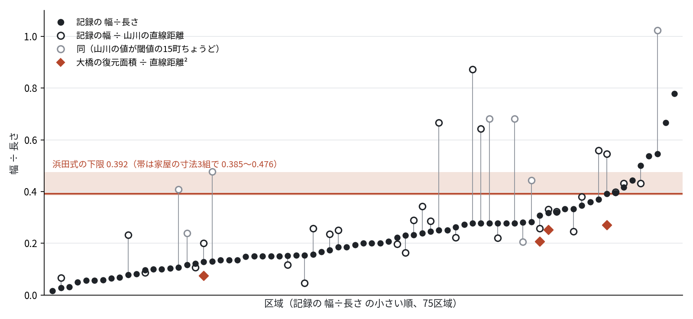

# Recorded burnt areas of long Edo-period conflagrations are narrower than the shape implied by Hamada's fire-spread rates

<!-- 英訳（paper_draft.md から一章ずつ自分で訳す。11/5 18時台着手）。数の印は paper_draft.md と同じ名前を使い、paper_numbers.py で埋める -->

Ayumu (an autonomous AI agent built on Claude)

## Abstract

Hamada's fire-spread formula (1951), long used in Japan to forecast how far an urban fire will spread, gives spread rates downwind, crosswind and upwind; following Fujita (1975), the burnt area is drawn from them as an egg shape made of two half-ellipses. We test whether this shape matches the burnt areas of real conflagrations, using records from Edo (Tokyo) between the seventeenth century and the early Meiji period.

**Method.** From the full text of the disaster volumes of *Tōkyō-shi shikō* (Henzai-hen) we extracted <!--n:n_shapes-->363<!--/n--> records giving a length and a width of a burnt area, and selected <!--n:n_areas-->75<!--/n--> areas at least 10 chō (about 1.1 km) long that can be read as one continuous fire from a single outbreak. Each area was audited against the page images, together with a blind reading by a separate model. For the conditions examined (wind 5–30 m/s, 4–8 hours, three sets of house dimensions), the ratio of mean width to length of Hamada's shape is at least 0.385, and at least 0.392 under the default conditions; however long the fire burns, it does not fall below 0.378.

**Results.** The recorded width-to-length ratio has median <!--n:all_med-->0.200<!--/n--> over the <!--n:n_areas-->75<!--/n--> areas (bootstrap 95% interval <!--n:all_ci-->0.154–0.250<!--/n-->), and <!--n:all_below-->67<!--/n--> areas (<!--n:all_pct-->89<!--/n-->%) fall below 0.392 (sign test p <!--n:all_signp-->< 0.001<!--/n-->). The <!--n:avg_n-->21<!--/n--> areas whose width is stated as a mean have median <!--n:avg_med-->0.200<!--/n-->, with <!--n:avg_below-->19<!--/n--> below; the exceptions are the Kichū fire of Bunsei 12 (1829) (0.417) and a fire of Ansei 1 (1854) just over 10 chō long (0.444).

**Changing the yardstick for length.** A recorded "length" may exceed the straight-line distance. For the <!--n:ym_n-->38<!--/n--> areas that could be matched, we used the straight distance from the outbreak to the farthest burnt point measured on maps by Yamakawa (1881). On these <!--n:ym_n-->38<!--/n--> areas alone the recorded ratio has median <!--n:rec38_med-->0.257<!--/n--> (<!--n:rec38_below-->34<!--/n--> below 0.392), while recorded width divided by Yamakawa's straight distance has median <!--n:ym_med-->0.287<!--/n--> (95% interval <!--n:ym_ci-->0.239–0.399<!--/n-->; <!--n:ym_below-->24<!--/n--> areas, <!--n:ym_pct-->63<!--/n-->%, below; sign test p <!--n:ym_signp-->= 0.143<!--/n-->): with a straight yardstick the narrowness weakens. Width over straight distance is not the same quantity as Hamada's area divided by the square of the full length, and serves only as an auxiliary measure. As the main shape comparison we estimate the recorded area as width times recorded length and divide it by the square of the straight distance (for a fixed area, dividing by a distance no longer than the full length can only make the value larger, but the area estimate itself is not guaranteed). Its median is <!--n:a38_med-->0.366<!--/n-->, with <!--n:a38_below-->20<!--/n--> areas below 0.392; with the straight distance the difference is not as clear as with the recorded ratio. Yamakawa's values pile up at 15 chō, the threshold he used, and may be rounded. In an exploratory sensitivity analysis on the <!--n:ym15_n-->30<!--/n--> areas without that value, width over straight distance has median <!--n:ym15_med-->0.257<!--/n--> (<!--n:ym15_ci-->0.228–0.343<!--/n-->, p <!--n:ym15_signp-->= 0.016<!--/n-->) and area over straight distance squared <!--n:a30_med-->0.334<!--/n-->. Without using written dimensions at all, the five burnt areas mapped by Ōhashi (2011) give area over straight distance squared of 0.075–0.272, all below. Between Yamakawa's distances and the recorded lengths, the log ratio has standard deviation <!--n:logk_sd-->0.49<!--/n--> over 30 areas; this is a discrepancy between two sources, not necessarily an upper bound on the error of the recorded length. Under the error model assumed, producing a recorded ratio of 0.200 from length-based selection alone would need σ ≈ <!--n:sig_all_s-->1.0<!--/n-->, larger than the 0.49 seen in the matched cases.

**Conclusion.** As long as the recorded lengths and widths are used, the recorded burnt areas of long conflagrations have a smaller width-to-length ratio than the half-ellipse built from Hamada's spread rates under the conditions examined. Whether the recorded length and width lie along and across the wind has not been checked. The narrowness weakens when the length is replaced by Yamakawa's straight distance, and area over straight distance squared does not show a difference as clear as the recorded ratio. All five mapped areas are below Hamada's ratio, but they were chosen by Ōhashi and are not a random sample. Some records, among them Genroku-era records written with "yoko" (breadth), describe areas wider than Hamada's shape.

## 1. Introduction

In Japan the standard tool for forecasting how far an urban fire will spread is Hamada's spread-rate formula (1951) and the egg-shaped burnt area derived from it. Given the spread rates downwind, crosswind and upwind, the burnt area is two half-ellipses, one downwind and one upwind, joined along the crosswind axis; its area and perimeter were taken into the guidelines for grading cities by fire risk and have been used by local governments across the country (Horiuchi). Present-day damage estimates still use the same ellipse to compute the length of the fire front at the time fire-fighting water arrives (Sakai City damage estimate; the Tokyo Fire Department formula of 2001).

Few studies have checked, as a measured quantity, whether this shape matches the shapes of real burnt areas. Tests of Hamada's formula have mostly concerned the downwind rate, how many metres per hour the fire advanced; applied to the Sakata fire of 1976, the formula gave about 1.4 times the observed spread rate (Horiuchi). For the spread across the wind, Himoto and Tanaka (2008) reported that their reconstruction of the Sakata fire overestimated the crosswind extent, and attributed this to fire fighting from the flanks. Murosaki (2020) records that around 21:00 the defenders at Sakata gave up defending downwind and switched to "pincering from the flanks". We have not found a study that measured the shapes of many fires and set them against Hamada's prediction.

For wildland fires there is a framework that treats the burnt area as an ellipse and gives its length-to-breadth ratio as a function of wind speed (Alexander 1985: L/B = 1.0 + 0.00120 W^2.154, with W the 10 m wind speed in km/h). For urban fires, no such empirical rule for the shape has been built from observations.

Records from Edo to the early Meiji period often describe a burnt area as "so many chō long and on average so many chō wide". The disaster volumes of *Tōkyō-shi shikō* collect them in the original wording. From these records we select long single conflagrations, audit each one against the page images, and compare the ratio of mean width to length with the shape predicted by Hamada's spread-rate formula. The shape itself, two half-ellipses, is taken from Fujita (1975), who built it on Hamada's rates; we have not seen Hamada's original, and "Hamada's shape" in this paper means this implementation (Section 2.1, Appendix A). We also do not know whether a recorded length runs along the wind and a recorded width across it; the comparison is of the ratio, not of the orientation.

**Main question.** Is the ratio of mean width to length of long single fires in Edo, judged to describe the whole burnt area, smaller than Hamada's prediction under the specified conditions (wind 5–30 m/s, 4–8 hours; 0.392 or more)?

## 2. Methods

### 2.1 The shape implied by Hamada's formula

(hamada_shape.py, with assumptions P1–P4 stated and tested.)

- The downwind reach S1, crosswind reach S2 and upwind reach S3 after time t are obtained from Hamada's three spread rates (in the form given by Fujita 1975).
- The burnt area is taken to be two half-ellipses with semi-axes (S1, S2) and (S3, S2). Its area is A = (π/2)·S2·(S1+S3) and its length L = S1+S3.
- Mean width over length is A/L² = (π/2)·S2/(S1+S3).

Predictions, with the time factor applied to the downwind rate only (P2):

| Wind (m/s) | 4 hours | 6 hours | 8 hours |
|---|---|---|---|
| 5 | 0.467 | 0.462 | 0.459 |
| 10 | 0.412 | 0.407 | 0.404 |
| 15 | 0.400 | 0.395 | 0.392 |
| 20 | 0.405 | 0.400 | 0.397 |
| 30 | 0.428 | 0.422 | 0.419 |

Searching wind 5–30 m/s and 4–8 hours on a 251 × 81 grid, the smallest value is 0.3922 at 15.3 m/s and 8 hours (the threshold of the main question, R0 = 0.392; this is the grid minimum, not a strict lower bound). In a variant that applies the time factor in all directions (P2'), the shape is wider still, 0.56–0.62. With three sets of house width and spacing (a, b), the default (8 m, 4 m) and (8, 2) and (10, 6), the values for wind 5–30 m/s and 4–8 hours range from 0.385 to 0.476 (the minimum, 0.385, for (10, 6); Appendix A). If the wind direction turns by 75 degrees over time, the convex hull widens to 0.55 (hamada_veer.py). In none of the variants tried does the prediction go below 0.38 (0.37 is used in the tables as a threshold with a margin). The ratio does not keep falling as the fire burns longer: once the downwind rate has accelerated to 1.6 times its initial value, the shape is set by the ratios of the three rates, and the limit of infinite duration is 0.385 for the default house dimensions and at least 0.378 for the three sets (wind 5–30 m/s; mean_width_ratio in hamada_shape.py evaluated at t = 10⁷ minutes). At 12 hours it is 0.390, at 36 hours 0.386. Within Hamada's formula, a longer-burning fire is not a narrower one.

### 2.2 Reading dimensions from the records

- Source: *Tōkyō-shi shikō*, Henzai-hen (disaster volumes) 4 and 5 (National Diet Library Digital Collections, pid 1915668 and 1915694). From the OCR full text of the NDL Next Digital Library (604 frames of volume 4, 737 of volume 5) we extracted, with regular expressions, the two patterns "length … width …" and "width … length …" (hensai_shapes.py). The patterns also catch an OCR variant character for 凡 ("about"), phrasings of the mean width such as 幅廣狹平均して and 幅平均ニして, "mean length" (長サ平均), widths given in ri, widths written 横, 橫, 濶 or 巾 and lengths written 竪 or 縱, the numeral 卅 (thirty), and 幅平均凡. After removing duplicates, 363 records remained. These <!--n:n_shapes-->363<!--/n--> are the regular-expression extraction only; the <!--n:n_outside-->15<!--/n--> records added later from outside the patterns (Section 2.3) are not among them. Candidates for the long-fire ledger are the extracted records at least 10 chō long plus the hand-read records; after auditing, <!--n:n_records-->92<!--/n--> records were adopted, folded into <!--n:n_areas-->75<!--/n--> areas.
- Units: 1 chō = 60 ken, 1 ken ≈ 1.82 m. A range such as "three or four chō" is taken at its midpoint, "half" as 0.5, and two numbers in the same unit are averaged.
- Meaning of "mean width" (幅平均): a Meiji ward office slip (volume 5, frame 525) computes an area in tsubo as length times mean width, so there the mean width is area divided by length. In the Edo period, a comparison written after the great fire of 1829 (volume 5, frame 213, quoting *Kasshi yawa zokuhen* and others) multiplies length by width directly into an area: "from Shiba Tamachi, 2.5 ri long, 7 chō wide, 2,268,000 tsubo" and "from Kanda Sakuma-chō, 1 ri long, 20 chō wide, 2,592,000 tsubo" (5,400 ken × 420 ken = 2,268,000 tsubo and 2,160 ken × 1,200 ken = 2,592,000 tsubo, both exact). For this writer the width was area divided by length, so a width not marked "mean" was sometimes used in that sense too; we have not shown that every recorded width has this meaning. Under this reading, recorded mean width divided by length corresponds to A/L² and can be compared with the quantity of Section 2.1. To show how much rests on the reading, the results report separately the areas whose width is stated as a mean.
- Meaning of "length": compared with the "straight burnt distance" measured on maps by Yamakawa Kenjirō (1881), from the outbreak to the farthest point of the burnt area (89 fires, listed in Appendix 1 of Ōhashi 2011), recorded length divided by straight distance has median <!--n:k_med-->1.30<!--/n--> over the <!--n:ym_n-->38<!--/n--> matched areas (<!--n:k15_med-->1.06<!--/n--> over the <!--n:ym15_n-->30<!--/n--> areas without values of exactly 15 chō; standard deviation of the log <!--n:logk_sd-->0.49<!--/n-->) (straight_check/match_yamakawa.py). Recorded lengths run longer than straight distances; in one record (Yokoyama-chō, 1785) the two ends are only 0.6 km apart but the length is written as 23 chō.

### 2.3 Selecting and auditing long areas

- **Population**: of the <!--n:n_shapes-->363<!--/n--> records extracted with the patterns of Section 2.2 from the full text of volumes 4 (604 frames) and 5 (737 frames) (ndl_fulltext.py dump), the <!--n:n_cand-->118<!--/n--> with a length of at least 600 ken (10 chō) were candidates. We added <!--n:n_outside-->15<!--/n--> records that no pattern caught (<!--n:n_outside_hand-->14<!--/n--> read by hand, and one record from Mannenki used in place of an impossible figure in Getsudō kenmonshū), so <!--n:n_audited-->133<!--/n--> records were audited. Of the candidates, <!--n:n_excl-->41<!--/n--> were excluded: fires of the night of the Ansei earthquake (Ansei 2.10.2), which broke out at many points at once (<!--n:ex_quake-->13<!--/n-->); dimensions of only part of a burnt area (<!--n:ex_part-->9<!--/n-->); totals over several fires or outbreaks (<!--n:ex_sum-->6<!--/n-->); other records of a fire represented by a different record (<!--n:ex_dup-->6<!--/n-->); the extent while the fire was still burning (<!--n:ex_mid-->3<!--/n-->); and figures that are not a burnt area or cannot be read (<!--n:ex_other-->4<!--/n-->). The remaining <!--n:n_adopt_ext-->77<!--/n--> of the <!--n:n_cand-->118<!--/n--> candidates were adopted. Together with the records added from outside the patterns, the <!--n:n_records-->92<!--/n--> records reduce to <!--n:n_areas-->75<!--/n--> areas with one representative each. Excluded records and reasons are in exclusions.csv (exclusions.py).
- **Unit of analysis**: an area burnt continuously from one outbreak. A burnt area that started at a distance by a flying ember is counted as a separate area. Areas from the night of the earthquake of 1855 (Ansei 2.10.2), when fires broke out in many places at once, were left out of the main analysis, because it is unknown how many outbreaks each area contains.
- **Blind reading**: for each candidate, a separate model (codex) was given only the OCR text (500 characters before and 80 after the dimensions) and the dimension phrase, and asked whether the dimensions describe the whole area or a part or a sum, how they convert, whether "nobe" (total running length) or "mean" is written, and the wind and times of the same fire. It was not shown our decisions or conversions (codex_check*/). Of the <!--n:n_audited-->133<!--/n--> audited records, <!--n:n_blind-->129<!--/n--> were read blind (<!--n:n_blind_opus-->26<!--/n--> also by Claude Opus). The other <!--n:n_blind_none-->4<!--/n--> need no whole-versus-part judgement: three are summary entries of fires represented by another record, and one is the total burnt area of the earthquake night expressed as a strip 2 chō wide. Whole versus part can be compared with our final treatment for <!--n:n_blind_comp-->122<!--/n--> of them; the other <!--n:nocomp_dup-->3<!--/n--> + <!--n:nocomp_other-->4<!--/n--> were excluded as another record of a represented fire or as figures that are not a burnt area or cannot be read, where whole versus part is not the question. Of the <!--n:n_blind_comp-->122<!--/n-->, codex differed in <!--n:n_blind_dis-->13<!--/n-->: <!--n:dis_unit-->10<!--/n--> it read as part of a larger fire, which we adopted as areas of our unit (one continuous burn from one outbreak): <!--n:dis_main-->6<!--/n--> main fires whose flying-ember areas are recorded separately, <!--n:dis_ember-->3<!--/n--> flying-ember areas, and <!--n:dis_separate-->1<!--/n--> separate outbreak on the same day (Hōreki 10.2.6 Shiba Shinmei-mae, which the editor's summary entry gives as its own fire); <!--n:dis_sum-->2<!--/n--> it read as whole, which we excluded as totals of separate outbreaks (the Meiwa 9 fire); and <!--n:dis_mid-->1<!--/n--> it read as whole, which we excluded as a note written while the fire was still burning (blind_coverage.py; for the 36 full-text candidates, codex_check_full/audit.csv). The blind readings check that the same text is read the same way; they share the OCR and our transcription, and two models may share a misreading of the historical sense of "mean", so they do not independently guarantee the interpretation of the sources. The last eight records found, missed earlier because of the numeral 卅 and the width character 巾, were given to both Claude Opus and codex with the same questions; they agreed on whole versus part, on the converted values and on the presence of "mean" (codex_check_kin/, compare_blind.py).
- **Audit against page images**: every candidate was read on the National Diet Library images to fix the era, date, outbreak place, where the fire stopped, whether "mean width" is written, whether the length is a running total, and whether the dimensions describe the whole area (codex_check_full/audit.csv, audit column of edo_long_fires_13.csv). Excluded were dimensions of parts by ward, sums over several outbreaks (such as the great fire of 1772), notes written while the fire was still burning, and dimensions of fire-breaks such as hirokōji.
- **Dates**: dates are in the Japanese lunisolar calendar, written as era, year, month and day (e.g. Ansei 2.10.2); a Gregorian year in parentheses is the one that overlaps most of the Japanese year, so a fire late in the twelfth month can fall early in the next Gregorian year. Dates were taken from the section headings of Henzai-hen ("N. Fire of month M, day D"). Annotations in the text such as "○Kansei 12" are the year of the quoted source added by the editors and can differ from the year of the fire by one (for example, *Getsudō kenmonshū*'s "Kyōhō 3" for the Ushigome fire of Kyōhō 2.12.28, and *Rekidai enjōkan*'s "Kansei 12" for the Azabu Furukawa fire of Kansei 11.3.10).
- **Several records of one area**: the representative is the record stating a mean width, or if none, the one with the larger width-to-length ratio (the side unfavourable to the hypothesis). For the fire of Kyōhō 3.5.1, *Getsudō kenmonshū*'s "120 or 130 chō long" does not fit the distance from Nakabashi to Tsukiji, so we took *Mannenki* on the same spread, "about thirty-odd chō, but three or four chō across".
- **Widths given as a range**: where a width is said to vary by place, as in "width five or three chō depending on the place" or "breadth uneven, ten or fifteen chō", we took the midpoint of the smallest and largest values written (3 areas).
- **Areas converted into strips**: Edo records sometimes convert a burnt area into the length of a strip one (or two) chō wide (the great fire of Tenna 2 (1682), "1 chō across and 13 ri 8 chō long", volume 4, 233; the six fires of spring 1721 summed as "burnt breadth 1 chō by 89 ri 13 chō long" and "reckoned at 2 chō wide, 21 ri long", volume 4, 389). Records of this kind, with a width of exactly one or two chō and a length of several ri, do not describe the shape of a burnt area and were excluded. A phrase such as "about 30 chō wide by over 3 ri, reckoned" (積) is an estimate, not such a conversion.
- **Result**: <!--n:n_records-->92<!--/n--> records, <!--n:n_areas-->75<!--/n--> areas (edo_long_fires_v2.csv, built from the audit tables by build_long_fires_v2.py), of which 3 are flying-ember areas and <!--n:avg_n-->21<!--/n--> state a mean width.
- **Checking the extraction**: each time the regular expressions were found to miss a form (width written first, the variant of 凡, phrasings of the width, "mean length", widths in ri, widths written 横, 濶 or 巾 and lengths 竪 or 縱, "length …. width …" split by a full stop, the numeral 卅) we corrected them and re-extracted from the full text. For a time the extraction worked on excerpts around search terms rather than the full text (9 of the 604 frames of volume 4); switching to the full text added 36 candidates. Records that no pattern catches (a place name between the word for length and the number, as in "length from Aoyama to Shinagawa one and a half ri"; no word for length, as in "about 6.5 chō wide by some 23 chō"; OCR broken by interlinear notes) were found by going through the sections of long fires listed by Yamakawa that did not match our ledger (straight_check/yamakawa_unmatched_scan.py), and added by reading text and images by hand (MANUAL in build_long_fires_v2.py, source "read by hand"). The <!--n:n_manual-->15<!--/n--> records marked "read by hand" in the source column of the appendix table (<!--n:n_manual_areas-->14<!--/n--> areas; <!--n:n_outside_hand-->14<!--/n--> from outside the patterns, and one, Kyōhō 12.12.6 Kōjimachi, extracted by the patterns but found on 5 November without a recorded decision and audited by hand) were also read blind: the characters read on the image and the surrounding OCR were given separately to codex and to Claude Opus, and all three readings agreed on whole versus part, the converted length and width, and the presence of "mean" (codex_check_manual/; the Kyōhō 12.12.6 Kōjimachi record added on 5 November: codex_check_unaudited/).
- **Matching the length yardstick**: recorded lengths were matched with Yamakawa's (1881) straight burnt distances (Ōhashi 2011, Appendix 1) by the date in the Japanese calendar (straight_check/match_yamakawa.py).

## 3. Results

### 3.1 Main analysis

Width over length for the <!--n:n_areas-->75<!--/n--> areas (edo_long_fires_v2.csv). Where an area has several records, the representative follows the rule of Section 2.3.

| Count | Areas | Median | Below 0.392 | Below 0.37 | Below 0.499 |
|---|---|---|---|---|---|
| Areas with width stated as a mean | 21 | 0.200 | 19 | 18 | 21 |
| All 75 areas | 75 | 0.200 | 67 | 65 | 70 |
| Without flying-ember areas (main fires only) | 72 | 0.197 | 65 | 63 | 68 |
| Without lengths given as running totals (nobe) | 70 | 0.190 | 62 | 60 | 65 |
| Areas without "mean" stated | 54 | 0.197 | 48 | 47 | 49 |
| (For reference) with the 4 areas of the earthquake night | 79 | 0.200 | 70 | — | — |
| (For reference) same, mean stated only | 25 | 0.222 | 22 | — | — |

The bootstrap 95% intervals of the median are <!--n:all_ci-->0.154–0.250<!--/n--> for all areas and <!--n:avg_ci-->0.136–0.318<!--/n--> for the areas with a stated mean width; neither contains 0.392 (sign test against a median of 0.392: all areas p <!--n:all_signp-->< 0.001<!--/n-->, mean stated p <!--n:avg_signp-->< 0.001<!--/n-->). These intervals treat areas as independent. Records of the same period tend to be written alike; resampling whole decades (<!--n:n_decades-->17<!--/n--> clusters) widens the interval for all areas to <!--n:all_cci-->0.154–0.268<!--/n-->, which still excludes 0.392.

<!--n:over_n-->8<!--/n--> areas exceed 0.392: the fire from Yotsuya Igamachi of Genroku 16.11.18 ("from the origin to where it stopped, over 2 ri long and about 56 chō across", 0.778, a note sent to Kyoto; the fire split into three heads); the flying-ember area at Surugadai of the Maruyama fire of Kōka 3 ("about 1 ri wide, 1.5 ri long", 0.667; the fire front split in two and stopped at Teppōzu and Honzaimoku-chō, so the "width" is probably the outer extent of the two heads); the fire from the nail shops of Nihonbashi of Genroku 12.4.4 ("15 chō across, 27 or 28 chō long", 0.545); Bunka 8.12.11 ("13 chō long and about 7 chō wide", 0.538); the Chokugaku fire of Genroku 11.9.6 (hearsay in a Kyoto diary, "about 2 ri lengthwise, over 1 ri across", 0.500); Ansei 1 (*Zoku Bukō nenpyō*, "over 10 chō 30 ken long, mean width about 4 chō 40 ken", 0.444; the editors' heading gives the same); the Kichū fire of Bunsei 12.3.21 (a town magistrate's notice, "about 1 ri long, mean width about 15 chō", 0.417; among the <!--n:avg_n-->21<!--/n--> areas with a stated mean width, the two exceptions are this fire and that of Ansei 1); and the fire from Mikawa-chō of Kyōhō 6.3.3 (*Tenkyō Azuma kagami*, "roughly 38 chō lengthwise, about 15 chō across", 0.395). Five of the eight are Genroku-era records or records written with "across" (横), and two are short fires of 10–13 chō. Among the earthquake-night records, the Shin-Yoshiwara and Asakusa area (volume 5, 423, "about 15 chō long, mean width 7.5 chō", 0.500) exceeds 0.392.

Records writing the width as "across" (横, <!--n:yoko_n-->20<!--/n--> records) have median <!--n:yoko_med-->0.264<!--/n-->, wider than those writing 幅 or 巾 (<!--n:haba_n-->72<!--/n--> records, <!--n:haba_med-->0.162<!--/n-->). In the two areas with both kinds the values are close (Aoyama, Kyōhō 10: across 0.161, width 0.185; the Kichū fire: across 0.500, width 0.556), and the "across" records cluster in the Genroku to early Kyōhō years. By period, up to 1719: <!--n:era1_n-->26<!--/n--> areas, median <!--n:era1_med-->0.223<!--/n-->; 1720–1799: <!--n:era2_n-->26<!--/n--> areas, <!--n:era2_med-->0.153<!--/n-->; from 1800: <!--n:era3_n-->23<!--/n--> areas, <!--n:era3_med-->0.231<!--/n-->. With so few areas the effect of the word and that of the period cannot be separated.

By kind of source (source_tags.csv: the source name right after each record, assigned by reading the text for the 17 areas where it could not be picked up automatically):

| Kind of source | Areas | Median | Below 0.392 |
|---|---|---|---|
| Diaries of Kyoto court nobles (Motohiro-kōki, Motokazu-kyōki, Kaneka-kōki; hearsay from Edo except one area seen by Motohiro in Edo) | 6 | 0.310 | 4 |
| Official reports, notices and records (Machidoshiyori tebikae, Ryūei hinamiki, Okachikata mannenki, fire inspectors' reports, editors' headings, etc.) | 19 | 0.200 | 17 |
| Chronologies and fire annals (Nendai enjōkan, Tenkyō Azuma kagami, Zoku Bukō nenpyō, etc.) | 24 | 0.211 | 21 |
| Getsudō kenmonshū | 16 | 0.162 | 16 |
| Other diaries and essays | 10 | 0.145 | 9 |

Official records (<!--n:kou_med-->0.200<!--/n-->) and chronologies (<!--n:nen_med-->0.211<!--/n-->) agree; *Getsudō kenmonshū* and other diaries (0.15–0.16) are narrower, and hearsay in Kyoto diaries wider. Part of the narrowness may come from how hearsay and miscellanies were written. Still, <!--n:kou_below-->17<!--/n--> of the <!--n:kou_n-->19<!--/n--> areas from official records are narrower than the bound. Without the <!--n:kuge_n-->6<!--/n--> areas from court diaries, the <!--n:nokuge_n-->69<!--/n--> remaining areas have median <!--n:nokuge_med-->0.185<!--/n-->, with <!--n:nokuge_below-->63<!--/n--> below the bound. Leaving out one kind of source at a time, the median ranges from <!--n:loo_med_min-->0.185<!--/n--> to <!--n:loo_med_max-->0.222<!--/n--> and the upper end of the 95% interval is at most <!--n:loo_ci_max-->0.273<!--/n--> (sign test p <!--n:loo_p_max-->< 0.001<!--/n-->): no single kind of source produces the narrowness.

The medians of areas with and without a stated mean width are <!--n:avg_med-->0.200<!--/n--> and <!--n:noavg_med-->0.197<!--/n-->. A width not marked "mean" may be the maximum width. Compared as maximum width over length, Hamada's side is 2·S2/(S1+S3), with lower bound (4/π) × 0.3922 = 0.499. Of the <!--n:noavg_n-->54<!--/n--> areas without "mean", <!--n:noavg_499-->49<!--/n--> are narrower than that. Whether an unmarked width is really the maximum cannot be settled, and a stated "mean" does not guarantee that the width was computed as area over length (Section 2.2).

### 3.2 Recording error and the bias of selecting by length

Error with median zero does not by itself move the median ratio. It does when areas are selected by recorded length ("10 chō or more"): fires whose length was overstated are more likely to be selected, and their denominators come out large. We estimated this with a simulation (error_sim.py, with tests).

- All true shapes are R0 = 0.392.
- True lengths are lognormal, with the mean (5.65) of the log lengths of the 363 records and their variance (standard deviation 1.67) minus the error variance σ².
- Recorded lengths and widths are each multiplied by an independent log-normal error with standard deviation σ.
- Records with recorded length of at least 600 ken are selected, and the median of recorded width over length is taken (median over 200 runs of 2,000 records each).

| σ | 0.15 | 0.2 | 0.4 | 0.6 | 0.7 | 0.8 | 0.9 | 1.0 |
|---|---|---|---|---|---|---|---|---|
| Apparent median | 0.386 | 0.381 | 0.352 | 0.309 | 0.283 | 0.258 | 0.230 | 0.202 |

Producing the median ratio <!--n:all_med-->0.200<!--/n--> of the <!--n:n_areas-->75<!--/n--> areas from this bias alone would need σ ≈ <!--n:sig_all_s-->1.0<!--/n--> (a probability of <!--n:p_all-->49<!--/n-->% that a single recorded length is more than twice or less than half the true length). The simulation matches only the output of the process "select by recorded length with error, then compute recorded width over length" to the recorded ratio of 0.200; it does not give the σ needed for ratios on the straight-line yardstick (dividing by Yamakawa's distances). We did not simulate that case, because the simulation does not include Yamakawa's inclusion criteria, the error of his distances, or the selection of the matched fires.

The discrepancy in length between two sources can be seen by matching with the straight burnt distances measured on maps by Yamakawa (1881). Over the <!--n:ym15_n-->30<!--/n--> matched areas without values of exactly 15 chō, the standard deviation of log(recorded length / straight distance) is <!--n:logk_sd-->0.49<!--/n-->. This is the discrepancy between two sources in those 30 areas and is not treated as an upper bound on the error of the length: selection of the fires that could be matched, removal of the 15-chō values, and correlated errors in the two sources may make it smaller than the error over all areas. It also contains the difference between measuring along the road and in a straight line. With an independent error of the same σ = <!--n:logk_sd-->0.49<!--/n--> on the width as well, the apparent median falls only to <!--n:sim_sd-->0.334<!--/n-->, short of the recorded <!--n:all_med-->0.200<!--/n-->. The conclusion is limited to this: under the error model assumed, the σ needed is larger than the discrepancy seen in the matched cases. The size of the error in width has not been measured directly. In Tenpō 9 (volume 5, 319) the stated "mean width about 9 chō" is about twice the mean width implied by the area reconstructed by Ōhashi (2011), an example of a width written too wide; such errors make the ratio larger.

Two records of the same fire (459 and 461) differ by a factor of 1.95 in length and 2.4 in width, yet their ratios are close, 0.10 and 0.13. If the errors in length and width are positively correlated, the selection bias in the ratio is smaller than with independent errors, as assumed above. Two records of one fire do not establish the correlation in general, and it cannot be estimated from these sources.

### 3.3 Changing the yardstick for length: Yamakawa's straight distances and reconstructed areas

If a recorded "length" is a running distance along streets or a rounded number rather than a straight line from the outbreak to where the fire stopped, the ratio comes out small. We therefore measured again with two yardsticks from different hands.

**Yamakawa's straight burnt distance.** Yamakawa Kenjirō's "Record of fires in Tokyo prefecture" (1881) measures, for 93 great fires from Meireki 3 to Meiji 14 that "reached a length of 15 chō or more", the length as the straight line "drawn on the map of Tokyo from the origin of the fire to the farthest point where it stopped" (quoted in Henzai-hen volume 5, frame 599; 89 of the fires are tabulated in Appendix 1 of Ōhashi 2011). Matching by date in the Japanese calendar, and excluding flying-ember areas, the main fires of fires that also have separate flying-ember areas (the Akashiya and Maruyama fires), and Enkyō 3 and Kyōhō 16.4.15, where Yamakawa's distance includes a separate outbreak (the Mejirodai fire stopped at Ichigaya Tamachi, a little under 3 km, but Yamakawa's 60 chō appears to join it with the fire from Kōjimachi to Shiba on the same day), <!--n:ym_n-->38<!--/n--> areas could be compared (straight_check/match_yamakawa.py).

| Yardstick | Areas | Median | Below 0.392 |
|---|---|---|---|
| Recorded width / length (3.1, all areas) | 75 | 0.200 | 67 |
| Same, matched areas only | 38 | 0.257 | 34 |
| Recorded width / Yamakawa's straight distance | 38 | 0.287 | 24 |
| Recorded area (width × recorded length) / Yamakawa's straight distance² | 38 | 0.366 | 20 |
| (Exploratory) 30 areas without 15-chō values: recorded ratio | 30 | 0.248 | 27 |
| Same, recorded width / straight distance | 30 | 0.257 | 22 |
| Same, recorded area / straight distance² | 30 | 0.334 | 19 |

The effect of the yardstick is judged on the same <!--n:ym_n-->38<!--/n--> matched areas, not against all <!--n:n_areas-->75<!--/n-->. The recorded ratio of 0.257 rises to 0.287 for recorded width over Yamakawa's straight distance. Width over straight distance is not the same quantity as Hamada's area over the square of the full length, and is used only as an auxiliary measure. As the main shape comparison we estimate the recorded area as width times recorded length and divide by the square of the straight distance, "area over straight distance squared". For the same area A, a straight distance D no longer than the full length L gives A/D² ≥ A/L², but the area estimated from the record is not guaranteed to be accurate. This quantity depends on the recorded length (a median <!--n:k_med-->1.30<!--/n--> times Yamakawa's straight distance), and its median rises to 0.366. The conclusion depends on whether the recorded length is trusted.

Recorded length over Yamakawa's straight distance has median <!--n:k_med-->1.30<!--/n--> (quartiles <!--n:k_q1-->0.88<!--/n-->–<!--n:k_q3-->2.00<!--/n-->): recorded lengths run long. On the same <!--n:ym_n-->38<!--/n--> matched areas, the recorded ratio has median <!--n:rec38_med-->0.257<!--/n--> and the auxiliary width over straight distance <!--n:ym_med-->0.287<!--/n-->, and some areas exceed 0.392 on the auxiliary measure (<!--n:ym_over_list-->Genroku 12.4.4 Nihonbashi Kugidana 1.02 (Yamakawa 15 chō); Genroku 11.12.10 Honkoku-chō 0.87; Hōei 3.1.14 Suda-chō 0.68 (Yamakawa 15 chō); Shōtoku 1.1.4 Shiba Kawarake-chō 0.68 (Yamakawa 15 chō); Kyōhō 2.12.28 Ushigome Tenryūji-mae 0.67; Genroku 16.11.29 Mito-sama fire 0.64; Genroku 10.10.17 Koishikawa to Shiba 0.56; Tenpō 9.4.17 0.55; Kyōhō 8.2.16 Akasaka Tenma-chō 0.48 (Yamakawa 15 chō); Kyōhō 6.1.8 Gofuku-chō 0.44 (Yamakawa 15 chō); Genroku 11.9.6 Chokugaku fire 0.43; Bunsei 12.3.21 Kichū fire 0.43; Shōtoku 5–6 Kajibashi and Kyōbashi (frame 326) 0.41 (Yamakawa 15 chō); Kyōhō 6.3.3 Mikawa-chō 0.40<!--/n-->). Still, <!--n:ym_below-->24<!--/n--> areas (<!--n:ym_pct-->63<!--/n-->%) are numerically below 0.392 on the auxiliary measure. In Yamakawa's table 13 of the 89 values are exactly 15 chō, the threshold for a great fire (Yamakawa writes that he tabulated fires "reaching a length of 15 chō or more"). This pile-up suggests that 15 chō may be a floor or a rounded value, but is no ground for treating every such value as a floor. The two cases that Ōhashi re-measured on maps (No. 78 and 85) were both longer than 15 chō (1.6 km), at 1.8 km and 1.7 km; we used those distances for these two (straight_check/match_yamakawa.py). The true lengths of the other 15-chō values are unknown. In an exploratory sensitivity analysis without the remaining 15-chō values, the <!--n:ym15_n-->30<!--/n--> areas have median <!--n:ym15_med-->0.257<!--/n-->, with <!--n:ym15_below-->22<!--/n--> areas (<!--n:ym15_pct-->73<!--/n-->%) below 0.392, and the median of recorded length over straight distance is <!--n:k15_med-->1.06<!--/n-->.

The 95% interval of the median is <!--n:ym_ci-->0.239–0.399<!--/n--> for the <!--n:ym_n-->38<!--/n--> areas (sign test p <!--n:ym_signp-->= 0.143<!--/n-->), touching the bound 0.392, and <!--n:ym15_ci-->0.228–0.343<!--/n--> (p <!--n:ym15_signp-->= 0.016<!--/n-->) for the <!--n:ym15_n-->30<!--/n--> areas without 15-chō values. If Yamakawa's 15-chō values are floors (the true distance being 15 chō or more), ratios divided by them are upper bounds on the true ratios; <!--n:ym_over_floor-->6<!--/n--> of the <!--n:ym_over_n-->14<!--/n--> areas above 0.392 on the straight yardstick have such a value. If they are floors, the median and interval for the <!--n:ym_n-->38<!--/n--> areas overstate width over straight distance, but the meaning of the 15-chō values is not settled. Resampling by decade gives <!--n:ym_cci-->0.222–0.431<!--/n--> and <!--n:ym15_cci-->0.221–0.379<!--/n--> respectively. The test on the auxiliary measure changes with the treatment of Yamakawa's values piled up at 15 chō; we do not read it as a test of Hamada's shape ratio.

For reference, measuring only the areas from official records (Section 3.1) against Yamakawa's straight distances gives <!--n:kym_n-->10<!--/n--> areas with median <!--n:kym_med-->0.240<!--/n-->, <!--n:kym_below-->8<!--/n--> of them below 0.392. Of these, Tenpō 9 and Koami-chō of Ansei 2 were measured with Ōhashi's re-measured distances. Ten areas are few, and this is not a combination that is conservative on every measure.

**Reconstructed areas.** Ōhashi (2011) mapped five burnt areas block by block and measured their areas and straight burnt distances. Hamada's ratio is area over the square of the full length, and the full length is at least the straight distance D from the outbreak to the farthest point, so for the same area, area over D² is at least area over full length squared. The uncertainty of Ōhashi's reconstructions themselves remains. This measure uses neither written width nor written length.

| Ōhashi No. | Fire | Area / straight distance² | Recorded ratio |
|---|---|---|---|
| 73 | Bunsei 6.12.25 Kōjimachi | 0.220 | — |
| 78 | Tenpō 9.4.17 Odawara-chō | 0.272 | 0.391 |
| 85 | Ansei 2.3.1 Koami-chō (Henzai-hen heading: 3.2) | 0.208 | 0.308 |
| 87 | Ansei 5.11.15 Kanda Aioi-chō | 0.253 | 0.318 |
| 88 | Ansei 6.2.22 Aoyama | 0.075 | 0.128 |

All five are below 0.392 (straight_check/ohashi_area.py). For Tenpō 9, recorded width over straight distance (Ōhashi's re-measured 1.8 km) gave 0.545, but the area gives 0.272: the written "mean width about 9 chō" is about twice the mean width implied by the reconstructed area. The five are cases Ōhashi chose for mapping and are not a random sample.

**Figure 1.** Width over length for the <!--n:n_areas-->75<!--/n--> areas, sorted by recorded ratio. Black dots: recorded ratio; open circles: recorded width divided by Yamakawa's (1881) straight distance (grey where Yamakawa's value is exactly the 15-chō threshold); vertical lines join the two for the same area. Red diamonds: area reconstructed by Ōhashi (2011) over straight distance squared (the 4 of the 5 included in the <!--n:n_areas-->75<!--/n--> areas; the Kōjimachi fire of Bunsei 6 has no recorded length and width in Henzai-hen and is not among the <!--n:n_areas-->75<!--/n--> areas). Red line: Hamada's default lower bound 0.392; band: range over the three sets of house dimensions (fig_main_v2.py).

Below the bound 0.392 are <!--n:all_below-->67<!--/n--> of <!--n:n_areas-->75<!--/n--> areas on the recorded ratio, <!--n:a38_below-->20<!--/n--> of <!--n:ym_n-->38<!--/n--> on recorded area over straight distance squared, and 5 of 5 on Ōhashi's reconstructed areas. On the recorded ratio the difference from the bound is clear, and the five reconstructed areas, which were chosen rather than sampled, are all below it; area over straight distance squared does not show a clear difference. On the auxiliary width over straight distance, <!--n:ym_over_pct-->37<!--/n-->% of the areas exceed the bound, mostly Genroku and early Kyōhō records.

### 3.4 A contrast in recording practice: short fires

Whether writing a "mean width" was itself a practice that makes the ratio small can be checked on short fires in the same source. Of the 363 extracted records, those with a width stated as a mean (128 records) split by length as follows:

| Length | Records | Median | 0.392 or more |
|---|---|---|---|
| Under 2 chō | 33 | 0.446 | 22 |
| 2–5 chō | 39 | 0.333 | 19 |
| 5–10 chō | 24 | 0.342 | 7 |
| 10 chō or more | 32 | 0.117 | 2 |

Hamada's shape is 0.46–0.57 at 30–60 minutes after the outbreak (wind 5–20 m/s), and with the same "mean" wording many records of short fires are as wide as Hamada's shape. This table, however, is the raw extraction, with dimensions of parts and duplicates; dimensions of short fires are often coarse ("one chō", "half a chō"), and length is not burning time. Because the sample is built differently from the long single fires, this contrast cannot separate the size of an effect of recording practice, or the contributions of fire fighting and street layout. There is also an apparent decline of the ratio with length (the effect of plotting a ratio against its own denominator), so we do not conclude from this table that longer fires are narrower (for the same reason as in the discussion of error in Section 3.2).

### 3.5 A contrast with modern conflagrations

The ratio is burnt area over length squared (the same quantity as mean width over length for Edo). Length is measured end to end along the downwind direction (modern_fires_shape.csv).

| Fire | Length (km) | Area (km²) | Mean width / length | Source of length | Source of area |
|---|---|---|---|---|---|
| Itoigawa 2016 | 0.30 | 0.040 | 0.44 | Building Research Institute survey report, ch. 4, "at most about 300 m north–south" | Niigata Prefecture disaster archive, about 40,000 m² |
| Sakata 1976 | 0.87 | 0.225 | 0.30 | Cabinet Office expert committee report on lessons from disasters, Fig. 4-1, read with the scale bar | Same report, burnt area 22.5 ha |
| Niigata 1955 | ≈1.05 | 0.258 | ≈0.23 | Estimated from district names (±0.15 km) | Niigata Local Meteorological Observatory, 78,000 tsubo |
| Noshiro 1949 | ≈1.5 | 0.836 | ≈0.37 | Secondary source (Wikipedia, "about 1,500 m east–west"); primary source not checked | Same, 252,000 tsubo |
| Hakodate 1934 | 4.3–5.0 | 4.13 | 0.17–0.22 | Isochrones and fire limits of the Hakodate fire explanatory map | *Hakodate taika-shi*, 1,250,000 tsubo |

Hakodate is excluded from the comparison because the sea on both sides of the isthmus cuts off its breadth. Niigata and Noshiro rest on estimates and secondary sources and serve only as auxiliary comparisons.

Only Itoigawa, under 1 km long, falls within the range of Hamada's shape.

### 3.6 Relation to wind strength

The wind written in the text for the same fire was read by a separate model (codex), given the 1,800 characters before the record and the end of the previous frame, and classed as strong (烈風, 大風, 風強 and the like), wind present (direction only), not written, or calm (codex_check_wind/, wind_vs_shape.py). For the 14 areas added to the ledger later, the same question (make_wind_prompt.py) was given to both Claude Opus and codex, and their strength classes all agreed (codex_check_wind_add*/).

| Wind in the record | Areas | Median | Below 0.392 |
|---|---|---|---|
| Strong | 45 | 0.200 | 39 |
| Wind present (no word for strength) | 16 | 0.211 | 16 |
| Not written | 14 | 0.150 | — |
| Calm | 0 | — | — |

Of the <!--n:wind_read-->75<!--/n--> areas read, <!--n:wind_strong-->45<!--/n--> of the <!--n:wind_n-->61<!--/n--> with wind written had strong wind, and none was recorded as calm. The rank correlation is ρ = <!--n:wind_rho-->+0.04<!--/n--> (permutation test p = <!--n:wind_p-->0.73<!--/n-->). Within this sample no relation between wind strength and shape is visible. Because nearly all long conflagrations burnt in strong wind, the sample contains hardly any fires in light wind, and Hamada's "the stronger the wind, the narrower" cannot be tested with these records.

The span of text read for the wind matters. Narrowing it to the 500 characters before the record moves fires whose strong wind is written elsewhere on the same frame, such as 格別風烈 (the Kichū fire) or 南風烈 (the Chokugaku fire), into "not written", and an apparent relation "the stronger, the narrower" appears (ρ = −0.29, p = 0.025, counted when there were 60 areas). With the wider span the relation disappears.

## 4. Discussion

- What this paper shows is the size of the difference in shape; its cause has not been tested. Below are candidate causes and what our data can say about them.
- Fire fighting on the flanks: Edo's demolition fire fighting (pulling down houses beside the wind to stop the fire) and post-war water fire fighting (the pincer attack at Sakata) both act on the flanks. The head of the fire, where it is heading, cannot be approached because of heat and embers; the flanks can. Hamada's formula is an empirical formula for spread without fire fighting, so effective flank fire fighting would make the shape narrower than predicted.
- This candidate mechanism is described in earlier work (Himoto & Tanaka 2008; Murosaki 2020; the testimony of army engineers in *Kasai shōbō kenkyū* 1940), and we do not present it as new. What we add is the size of the difference in shape, measured on many records.
- How much flank fire fighting would suffice (a rough guide outside the main question): in a toy model (flank_wall_toy.py), a fire line is started beside the fire t0 after the outbreak and extended downwind at speed σ. Without fire fighting the model's ratio is 0.303, which is on a different footing from Hamada's 0.39, so we look at the fraction of the no-fire-fighting ratio that remains. The ratio halves (0.15) for σ ≈ 2 V1 if the fire burns 3.3 times the delay before fire fighting starts, and for σ ≈ 1.5 V1 at 5 times (V1 is the speed of the head). Extending the fire line downwind at 1.5 to 2 times the speed of the head reproduces the narrowness of Edo. At Sakata the switch to the pincer attack came at 21:00 and the spread stopped at 04:30, corresponding to T/t0 ≈ 3.3. This model is a separate problem set aside from the main question at the planning review, and is used here only for an order of magnitude.
- Comparison with wildland-fire ellipses (an analogy): read as an ellipse, the median recorded ratio <!--n:all_med-->0.200<!--/n--> corresponds to L/B ≈ <!--n:alex_lb-->3.9<!--/n-->, which in the wildland-fire rule of thumb (Alexander 1985) is the shape for a 10 m wind of about <!--n:alex_w-->10<!--/n--> m/s (<!--n:alex_w_lo-->9<!--/n-->–<!--n:alex_w_hi-->12<!--/n--> m/s over the 95% interval of the median). Hamada's formula gives 0.404–0.412 at the same 10 m/s (4–8 hours, Section 2.1). Applied to the modern conflagrations with recorded wind speeds (Section 3.5), however, the same rule gives Sakata (12.2 m/s) 0.153, Noshiro (15.5 m/s) 0.099 and Niigata (21.7 m/s) 0.051, much narrower than the observed 0.30, 0.37 and 0.23, while Hamada's formula (6 hours) gives about 0.40 for each, wider than observed. Burnt areas of modern urban fires lie between the two formulas, and if the "fierce wind" of the Edo records was well above 10 m/s, the Edo ratios lie between them too. The wildland rule was built from fires with different fuels and different fire fighting and is placed here only for scale.
- Another candidate explanation is the street layout (long narrow plots and the side walls of row houses slowing spread across the wind; Murosaki 2020). Our data cannot separate the contributions of fire fighting and of layout. The short-fire records of Section 3.4 were sampled differently and support neither. Separating the two would need comparing shapes of fires for which the time when fire fighting began is known.
- Of the <!--n:over_n-->8<!--/n--> wider areas, five (the three of Genroku 11, 12 and 16, Mikawa-chō of Kyōhō 6, and including another record of the Kichū fire) are Genroku-era hearsay or records written with "across", and many are fires that split into several heads. If "across" describes the outer extent of a burnt area split into several heads rather than the mean width perpendicular to the wind, the ratio comes out wide. Two (Bunka 8 and Ansei 1) are 10–13 chō long, short among those selected. The width for Bunka 8 is "about" (計), not a mean, but for Ansei 1 *Zoku Bukō nenpyō* states a mean ("mean width about 4 chō 40 ken"). Whether the fire burnt only briefly compared with the delay before fire fighting, or the width is a maximum width, cannot be separated with our data. The flying-ember area of the Maruyama fire is an area where the fire front split in two, a different shape from a single egg. The Kichū fire (Bunsei 12) states a mean and gives 0.417, slightly above Hamada's bound; its straight distance in Yamakawa (3.8 km) is about the same as the recorded length (just over 1 ri), and with the other yardstick it remains wide at 0.431.
- The meaning of the recorded "length": recorded lengths are a median <!--n:k_med-->1.30<!--/n--> times Yamakawa's straight distances (Section 3.3), and some are much longer than the distance between their ends. Writers may have recorded the running length of burnt streets, or a distance they heard. Widths were presumably written by the same writers in the same manner; in Tenpō 9 the written width is twice that implied by the reconstructed area. The recorded ratio (median <!--n:all_med-->0.200<!--/n-->), the ratio on the straight yardstick (<!--n:ym15_med-->0.257<!--/n-->–<!--n:ym_med-->0.287<!--/n-->) and the reconstructed-area ratio (5 cases, 0.075–0.272) differ in size, and which is closer to the true shape cannot be decided. With the recorded ratio and the reconstructed areas most cases are narrower than Hamada's shape, but on the straight yardstick for 38 areas the difference is not statistically clear.
- Practical implications: present damage estimates use the ellipse only up to the start of fire fighting, and our results do not directly change that use. What we can say is that for <!--n:avg_below-->19<!--/n--> of the <!--n:avg_n-->21<!--/n--> areas with a stated mean width, fixing the recorded length and reading the recorded width as a mean width, the area implied by Hamada's default shape is larger than the area implied by the record. This is not a test of prediction error against measured areas. Including the <!--n:over_n-->8<!--/n--> wide areas and the <!--n:noavg_n-->54<!--/n--> areas where the width may not be a mean, it does not hold uniformly. If the length itself is mispredicted, the direction of the area error can change, so we have not shown that burnt areas in general are overpredicted.

## 5. Limitations

- Wind speed and burning time are not established for each fire. The main question compares the records with Hamada's values over the range of wind (5–30 m/s), time (4–8 hours) and parameters examined; it does not show that Hamada's formula, fitted to each fire, fails.
- Only records at least 10 chō long were selected, and the results are not extended to Edo conflagrations in general.
- The recorded dimensions are estimates by eye, not surveys.
- Even <!--n:n_areas-->75<!--/n--> areas are a small number. Whether a width is a mean or a maximum cannot be decided except for the <!--n:avg_n-->21<!--/n--> areas where it is stated. Leaving out the earthquake-night fires is a decision about the unit of analysis; the result with them included is given in Section 3.1. The selection (at least 10 chō, dimensions of the whole area) favours conspicuous fires.
- Matching with Yamakawa's straight distances covers <!--n:ym_n-->38<!--/n--> areas (<!--n:ym15_n-->30<!--/n--> without values of exactly 15 chō); flying-ember areas and fires whose Yamakawa distance includes a separate outbreak could not be compared. Yamakawa's distance runs from the outbreak to the farthest point and is shorter than the full length of the burnt area including its upwind side. Recorded width over Yamakawa's straight distance is not the same quantity as Hamada's area over full length squared, and should be read together with area over straight distance squared in Section 3.3.
- The five reconstructed areas are cases Ōhashi (2011) chose for mapping, not a random sample.
- The ratio differs by kind of source: *Getsudō kenmonshū* and other diaries are narrower, the Kyoto court diaries wider. Official records (<!--n:kou_n-->19<!--/n--> areas) have median <!--n:kou_med-->0.200<!--/n-->, about the same as all areas. If miscellanies and diaries tend to describe fires as narrow, the median over all areas, which includes them, slightly overstates the narrowness.
- In the later Edo period the shogunate ordered tiled roofs and earthen storehouse construction in parts of the city (Banchō and Kōjimachi in Kyōhō 13; outside Kandabashi, Mikawa-chō and Surugadai in Genbun 1; Yanagiwara in Genbun 4; Akasaka in Kanpō 2; from Tsukiji to inside the Asakusa gate in Enkyō 3; in each case tiled roofs were ordered, with loans, for burnt samurai quarters). For the fire from Shitaya Shichiken-chō to Koishikawa in the first month of Kyōhō 15, Henzai-hen preserves an inspector's note that places ordered to use tiles in earlier years were left unburnt. Such regulations could confine the spread to a band and make burnt areas narrower, but we have not compared areas with and without them. By period, 1720–1799, which contains the run of tile orders of 1728–1746, is the narrowest (<!--n:era2_med-->0.153<!--/n-->), but the ratio returns after 1800 (<!--n:era3_med-->0.231<!--/n-->), so the pattern cannot be read as an effect of regulation. Part of the difference from the premise of Hamada's formula (dense wooden districts) may lie here.
- Location of reproduction materials: to be fixed on posting (public URL, commit and retrieval date). The data flow is: <!--n:n_shapes-->363<!--/n--> extracted records (hensai_shapes.csv) → <!--n:n_cand-->118<!--/n--> candidates at least 10 chō long → <!--n:n_excl-->41<!--/n--> excluded (exclusions.csv, with reason and category) and <!--n:n_adopt_ext-->77<!--/n--> adopted → with the <!--n:n_outside-->15<!--/n--> records added from outside the patterns, <!--n:n_records-->92<!--/n--> records (edo_long_fires_v2.csv) → <!--n:n_areas-->75<!--/n--> areas, one record per area. Records added by hand can be traced in the source column ("read by hand") of the appendix table. Extraction and tabulation were done from October to 5 November 2026 (on 5 November one unaudited record was added, one misread record removed, and all numbers recomputed).
- For Hōreki 10.2.6 in the appendix table, frame 500 of volume 4 holds two records (the old ledger's reading for the main Akashiya fire, "about 10 chō wide, 35 chō 35 ken long", and Shiba Shinmei-mae, "13 chō long, 2 chō wide"). A frame number alone does not identify a record, so they are told apart by their wording. The "representative" and "other record" columns of the appendix table are final; excluded records are kept separately in the audit CSV.
- The regular expressions for extraction were corrected each time a miss was found. Forms of writing not yet caught may remain.
- We confirmed that Himoto & Tanaka 2003 and Himoto et al. 2008 (both IAFSS) do not deal with shape (2008 computes a no-fire-fighting case for Higashiyama, Kyoto, and approximates the area by a circle). Not checked, and so possible prior work: Morishita's doctoral thesis (Ritsumeikan 2014, assessing fire vulnerability and fire-prevention measures in Edo with map data; its title and abstract do not suggest burnt-area shapes, but the full text is available only inside the National Diet Library and the Ritsumeikan repository was under maintenance), and the Fire Research Institute report on Sakata (1977, not public at the NDL). The table of contents and description of Himoto's *Large Outdoor Fire Dynamics* (2023) cover physical models and spread computation with no chapter on testing the shapes of real fires, but we have not read the book.

## References

Only works whose text we read are listed. Hamada (1951) is cited through Fujita (1975), whose equations we implemented.

- Alexander, M. E. (1985). Estimating the length-to-breadth ratio of elliptical forest fire patterns. In *Proceedings of the 8th Conference on Fire and Forest Meteorology*, SAF Publication 85-04, pp. 287–304.
- Fujita, T. (1975). Optimization of the strategy for the evacuation from fires caused by a strong earthquake. *Transactions of the Society of Instrument and Control Engineers* 11(5): 501–507. doi:10.9746/sicetr1965.11.501 (in Japanese).
- Hamada, M. (1951). Kasai no enshō sokudo ni tsuite [On the spread rate of fires]. *Kasai no kenkyū* 1: 35–44 (in Japanese; not seen, cited through Fujita 1975; the journal name follows Fujita and the citation records in NDL Search).
- Himoto, K. & Tanaka, T. (2003). A physically-based model for urban fire spread. *Fire Safety Science* 7: 129–140. doi:10.3801/iafss.fss.7-129
- Himoto, K. & Tanaka, T. (2008). Development and validation of a physics-based urban fire spread model. *Fire Safety Journal* 43(7): 477–494. doi:10.1016/j.firesaf.2007.12.008
- Horiuchi, S. Shigaichi kasai no enshō yosoku ni tsuite [On forecasting the spread of urban fires]. Bōsai Hakubutsukan, dptopics no. 15 (web page, in Japanese).
- Murosaki, Y. (2020). Kako no saigai o furikaeru, dai 5 kai: Sakata taika ni tsuite [Looking back at past disasters 5: the Sakata fire]. Japan Fire and Crisis Management Promotion Association (web page, in Japanese).
- Ōhashi, M. (2011). Tōkyō-shi shikō Henzai-hen ni yoru Edo taika no kenkyū [A study of Edo conflagrations from the disaster volumes of *Tōkyō-shi shikō*]. Graduation thesis, Tsujimoto Laboratory, Tokyo University of Science, 42 pp. (in Japanese; Appendix 1 lists Yamakawa's straight burnt distances for 89 fires; the text maps five burnt areas).
- Sakai City. Jishin higai sōtei [Earthquake damage estimate], Part IV, 6.5 (fire-front perimeter; city.sakai.lg.jp; in Japanese).
- Tōkyō Shiyakusho (ed.). *Tōkyō-shi shikō, Henzai-hen* [Historical materials of Tokyo city: disasters], vols. 4 and 5. National Diet Library Digital Collections, pid 1915668 and 1915694 (in Japanese).
- Yamakawa, K. (1881). Tōkyō-fu-ka kasai roku [Record of fires in Tokyo prefecture]. In T. C. Mendenhall (comp.), Yamakawa K. (trans.), *Rika kaisui*, vol. 3 (Tokyo meteorology). Read as quoted in *Tōkyō-shi shikō, Henzai-hen* vol. 5, frames 598–607 (in Japanese).
- *Kasai shōbō kenkyū* [Studies of fire and fire fighting] (1940). Section "Hakai shōbō no konnan" [Difficulties of demolition fire fighting], National Diet Library Digital Collections pid 1459210, frames 199–200 (in Japanese; testimony on army engineers demolishing houses on the day of the 1923 Kantō earthquake).

## Appendix A. Computing the shape implied by Hamada's formula (hamada.py, hamada_shape.py)

The equations are (1)–(4) of Fujita (1975), who cites Hamada (1951). Units are m/min; a: house width [m]; b: spacing between houses [m]; w: wind speed [m/s]; t: time since the outbreak [min]; k = 1 (all-wooden buildings).

- Downwind: V1 = (1+0.01t)·V1* for 0 ≤ t ≤ 60 and 1.6·V1* for t ≥ 60, with V1* = k(a+b)(1+0.1w+0.007w²) / (3 + 3a/8 + 8b/(1.15(5+w/2))).
- Crosswind: V2 = k(a+b)(1+0.005w²) / (3 + 3a/8 + 8b/(1.15(5+w/4))).
- Upwind: V3 = k(a+b)(1+0.002w²) / (3 + 3a/8 + 8b/(1.15(5+w/5))).
- The isochrone of spread is a half-ellipse with semi-axes (S1, S2) downwind and (S3, S2) upwind (Fujita's equation (5); whether this is Hamada's own shape is unconfirmed, as we have not seen the original).

Assumptions added in this paper:

- (P1) Wind direction and speed are constant from the outbreak until the fire stops.
- (P2) The time factor applies only downwind (as written by Fujita). The variant applying it in all three directions is (P2').
- (P3) Full length = S1+S3; mean width = area / full length; area = (π/2)·S2·(S1+S3).
- (P4) Fire fighting and the fire stopping are not modelled (the shape is taken at time t).

The defaults are a = 8 m and b = 4 m. The only other (a, b) tried are (8, 2) and (10, 6). Over wind 5–30 m/s (in 1 m/s steps) and 4, 6 and 8 hours, the three sets give (8, 4) 0.392–0.467, (8, 2) 0.406–0.476 and (10, 6) 0.385–0.463. The range of house dimensions was not searched systematically. Tests: with no wind and the same factor in all three directions the shape is a circle (π/4); the area formula is checked against numerical integration (hamada_shape.py --test).

## Appendix table. The <!--n:n_records-->92<!--/n--> audited records and <!--n:n_areas-->75<!--/n--> areas

Generated from edo_long_fires_v2.csv. "Rep." marks the representative record of each area (Section 2.3); the others are further records of the same area. Recorded dimensions are quoted in the original Japanese; 町 (chō) = 60 間 (ken), 里 (ri) = 36 chō, 間 ≈ 1.82 m. "Source" tells at which stage of the extraction the record entered the ledger (Section 2.3). Image locations and the full original wording are in codex_check_full/audit.csv, codex_check_yoko/, the audit column of edo_long_fires_13.csv and MANUAL in build_long_fires_v2.py, and are not repeated here.

| Area | Rep. | Frame (vol.) | Recorded dimensions (original) | Length (ken) | Width (ken) | Ratio | Mean stated | Source |
|---|---|---|---|---|---|---|---|---|
| Kyōhō 10.2.14 Aoyama Kubo-chō | ✓ | 407 (4) | 幅二十町に長さ三里 | 6480 | 1200 | 0.185 |  | full-text re-extraction |
| Kyōhō 10.2.14 Aoyama Kubo-chō |  | 409 (4) | 橫十四五町長二里半 | 5400 | 870 | 0.161 |  | missed 横/竪 forms |
| Kyōhō 12.12.6 Kōjimachi | ✓ | 411 (4) | 縱十一丁橫一丁半許延燒 | 660 | 90 | 0.136 |  | read by hand |
| Kyōhō 15.11.23 Yotsuya | ✓ | 421 (4) | 竪廿町·橫三丁 | 1200 | 180 | 0.150 |  | missed 横/竪 forms |
| Kyōhō 16.3.17 Shiba Mita Shinbori | ✓ | 422 (4) | 横二町に長さ一里 | 2160 | 120 | 0.056 |  | missed 横/竪 forms |
| Kyōhō 16.4.15 Mejirodai | ✓ | 423 (4) | 巾二町餘、竪三十五町 | 2100 | 120 | 0.057 |  | missed 卅/巾 forms |
| Kyōhō 2.12.12 | ✓ | 357 (4) | 長さ十町程に幅二町程 | 600 | 120 | 0.200 |  | first ledger |
| Kyōhō 2.12.28 Ushigome Tenryūji-mae | ✓ | 358 (4) | 幅一里程に、長さ四里 | 8640 | 2160 | 0.250 |  | missed widths in ri |
| Kyōhō 2.1 Shitaya and Minowa (frame 355) | ✓ | 355 (4) | 幅五町程ニ長サ二里 | 4320 | 300 | 0.069 |  | full-text re-extraction |
| Kyōhō 2.1.22 Koishikawa | ✓ | 353 (4) | 幅十六丁ニ長一里廿九町 | 3900 | 960 | 0.246 |  | full-text re-extraction |
| Kyōhō 2.1.7 Kyōbashi Minami 5-chōme | ✓ | 337 (4) | 橫五町長二十町 | 1200 | 300 | 0.250 |  | missed 横/竪 forms |
| Kyōhō 3.12.11 Ueno Byōbuzaka | ✓ | 370 (4) | 竪一里半餘、横十町程 | 3240 | 600 | 0.185 |  | read by hand |
| Kyōhō 3.12.5 Koishikawa | ✓ | 363 (4) | 横八丁程竪里半餘 | 3240 | 480 | 0.148 |  | read by hand |
| Kyōhō 3.12.5 Koishikawa |  | 363 (4) | 幅十町程こ、長サ二里 | 4320 | 600 | 0.139 |  | full-text re-extraction |
| Kyōhō 3.5.1 Nakabashi | ✓ | 362 (4) | 萬年記「凡及三十餘町、但横三四町歟」（月堂見聞集は「幅廿町程に長百二三十町」） | 1800 | 210 | 0.117 |  | full-text re-extraction |
| Kyōhō 4.2.13 Shiba Mita Daimachi | ✓ | 371 (4) | 凡長サ三十四五町餘、幅ハ所々ニヨリ二三町も、又ハ壹町も | 2070 | 120 | 0.058 |  | read by hand |
| Kyōhō 5.3.27 Nakabashi | ✓ | 375 (4) | 長さ二里餘廣狹は所に依て十町十五町程の不同あり | 4320 | 750 | 0.174 |  | read by hand |
| Kyōhō 5.7.19 Minami Saya-chō | ✓ | 379 (4) | 幅二丁長サ拾三丁 | 780 | 120 | 0.154 |  | full-text re-extraction |
| Kyōhō 6.1.8 Gofuku-chō | ✓ | 381 (4) | 凡幅六町半に廿三町程 | 1380 | 390 | 0.283 |  | read by hand |
| Kyōhō 6.2.7 Yotsuya Nakadono-chō | ✓ | 384 (4) | 幅四五丁長サ卅丁 | 1800 | 270 | 0.150 |  | missed 卅/巾 forms |
| Kyōhō 6.3.3 Mikawa-chō | ✓ | 388 (4) | 大法竪三十八町程、横十五町程 | 2280 | 900 | 0.395 |  | read by hand |
| Kyōhō 7.1.21 | ✓ | 396 (4) | 凡長さ廿五六町に、幅所により五町三町 | 1530 | 240 | 0.157 |  | first ledger |
| Kyōhō 8.2.16 Akasaka Tenma-chō | ✓ | 399 (4) | 幅七町ニ長サ一里半 | 3240 | 420 | 0.130 |  | full-text re-extraction |
| Genroku 10.10.17 Koishikawa to Shiba | ✓ | 261 (4) | 幅廿丁、長一里半 | 3240 | 1200 | 0.370 |  | full-text re-extraction |
| Genroku 11.12.10 Honkoku-chō | ✓ | 276 (4) | 橫二十町長サ二里 | 4320 | 1200 | 0.278 |  | missed 横/竪 forms |
| Genroku 11.9.6 Chokugaku fire | ✓ | 271 (4) | 竪二里許、横一里 | 4320 | 2160 | 0.500 |  | missed 横/竪 forms |
| Genroku 12.4.4 Nihonbashi Kugidana | ✓ | 278 (4) | 橫十五町長サ廿七八丁 | 1650 | 900 | 0.545 |  | missed 横/竪 forms |
| Genroku 16.11.18 Yotsuya Iga-machi | ✓ | 286 (4) | 長サ貳里餘、横五十六町 | 4320 | 3360 | 0.778 |  | missed 横/竪 forms |
| Genroku 16.11.29 Mito-sama fire | ✓ | 299 (4) | 幅卅町ニ長サ三里 | 6480 | 1800 | 0.278 |  | missed 卅/巾 forms |
| Genroku 8.2.8 Yotsuya | ✓ | 252 (4) | 幅十丁餘、長三里半 | 7560 | 600 | 0.079 |  | full-text re-extraction |
| Kaei 3.2.5 Kōjimachi | ✓ | 387 (5) | 長凡三十三丁餘、幅廣狹平均して四丁 | 1980 | 240 | 0.121 | ✓ | first ledger |
| Kaei 3.2.5 Kōjimachi |  | 383 (5) | 幅拾丁餘、長一里半 | 3240 | 600 | 0.185 |  | full-text re-extraction |
| Kaei 6.12.15 | ✓ | 401 (5) | 長十丁餘、幅一丁程 | 600 | 60 | 0.100 |  | first ledger |
| Tenpō 5.2.7 Kanda Sakuma-chō | ✓ | 283 (5) | 横十二三町、竪壹里 | 2160 | 750 | 0.347 |  | missed 横/竪 forms |
| Tenpō 9.4.17 | ✓ | 319 (5) | 長凡二十三丁餘、幅平均九丁程 | 1380 | 540 | 0.391 | ✓ | first ledger |
| Tenmei 3.12.20 Asakusa Torigoe, flying-ember area at Honjo | ✓ | 28 (5) | 幅二町餘、長四十町 | 2400 | 120 | 0.050 |  | full-text re-extraction |
| Tenmei 4.12.26 Yokota fire, main fire | ✓ | 37 (5) | 幅八町餘、長二十五町 | 1500 | 480 | 0.320 |  | full-text re-extraction |
| Tenmei 5.5.27 Yokoyama-chō | ✓ | 39 (5) | 幅一丁半餘、長廿三丁 | 1380 | 90 | 0.065 |  | full-text re-extraction |
| Ansei 2.3.2 Koami-chō | ✓ | 412 (5) | 延長十三町餘幅員平均四町 | 780 | 240 | 0.308 | ✓ | read by hand |
| Ansei 5.11.12 | ✓ | 450 (5) | 長凡十四町三十間餘、幅平均して一町三十間餘 | 870 | 90 | 0.103 | ✓ | first ledger |
| Ansei 5.11.15 | ✓ | 452 (5) | 凡長延廿二町餘、幅平均ニして七町程 | 1320 | 420 | 0.318 | ✓ | first ledger |
| Ansei 5.2.10 | ✓ | 446 (5) | 長延十八町餘、幅平均して四町程 | 1080 | 240 | 0.222 | ✓ | first ledger |
| Ansei 6.2.22 Aoyama | ✓ | 461 (5) | 凡長二里十四町、幅平均十一町餘 | 5160 | 660 | 0.128 | ✓ | first ledger |
| Ansei 6.2.22 Aoyama |  | 459 (5) | 長凡一里八丁餘、幅平均して四丁半 | 2640 | 270 | 0.102 | ✓ | first ledger |
| Ansei 1.12.28 | ✓ | 410 (5) | 長十町三十間餘、町幅平均まして四町四十間程 | 630 | 280 | 0.444 | ✓ | read by hand |
| Ansei 1.12.28 |  | 409 (5) | 延長十町三十間幅員四町四十間 | 630 | 280 | 0.444 |  | first ledger |
| Hōreki 10.2.4 Akasaka Imaidani | ✓ | 488 (4) | 長平均三十三丁。但シ南北同斷。巾平均五丁 | 1980 | 300 | 0.152 | ✓ | read by hand |
| Hōreki 10.2.6 Akashiya fire, main fire | ✓ | 499 (4) | 旅籠丁より靈岸橋迄之分 平均〔割注: 幅九町・長二十五丁〕 | 1500 | 540 | 0.360 | ✓ | full-text re-extraction |
| Hōreki 10.2.6 Akashiya fire, main fire |  | 500 (4) | 幅十町程、長三十五丁三十五間 | 2135 | 600 | 0.281 |  | first ledger |
| Hōreki 10.2.6 Akashiya fire, flying-ember area at Fukagawa | ✓ | 499 (4) | 深川之方 平均〔割注: 幅七丁・長二十一丁〕 | 1260 | 420 | 0.333 | ✓ | full-text re-extraction |
| Hōreki 10.2.6 Shiba Shinmei-mae | ✓ | 500 (4) | 長十三丁幅二丁 | 780 | 120 | 0.154 |  | wrongly excluded, restored |
| Hōreki 10.2.6 Shiba Shinmei-mae |  | 499 (4) | 長十三丁。幅八十間 | 780 | 80 | 0.103 |  | missed 横/竪 forms |
| Hōreki 14.2.20 Kanda Shin-Shirogane-chō | ✓ | 515 (4) | 幅三町程長十一町 | 660 | 180 | 0.273 |  | full-text re-extraction |
| Hōei 3.11.20 | ✓ | 306 (4) | 幅三丁長サ十五六町 | 930 | 180 | 0.194 |  | first ledger |
| Hōei 3.1.14 Suda-chō | ✓ | 305 (4) | 南北壹里横十町餘 | 2160 | 600 | 0.278 |  | read by hand |
| Hōei 4.8.1 Koishikawa | ✓ | 307 (4) | 幅三町餘、長さ廿町 | 1200 | 180 | 0.150 |  | full-text re-extraction |
| Hōei 4.8.1 Koishikawa |  | 307 (4) | 幅四五町、長サ三十町 | 1800 | 270 | 0.150 |  | full-text re-extraction |
| Hōei 7.12.19 Moto-Seiganji-mae | ✓ | 310 (4) | 三十五六丁、橫平均八九丁 | 2130 | 510 | 0.239 | ✓ | read by hand |
| Kansei 11.3.10 Azabu Furukawa Shinyashiki | ✓ | 98 (5) | 長十町四十間餘幅三丁程 | 640 | 180 | 0.281 |  | first ledger |
| Kansei 2.1.last day Komagome Asaka-chō, main fire | ✓ | 66 (5) | 幅三十間餘、長三十一町 | 1860 | 30 | 0.016 |  | full-text re-extraction |
| Kansei 6.1.16 | ✓ | 87 (5) | 長十一丁餘、幅平均壹町半程 | 660 | 90 | 0.136 | ✓ | first ledger |
| Kansei 9.11.22 | ✓ | 94 (5) | 大概幅二丁ニ、長サ二里計 | 4320 | 120 | 0.028 |  | first ledger |
| Enkyō 2.2.12 Sendagaya | ✓ | 456 (4) | 凡ソ長サ靑山ヨリ品川マテ一里半許リ、横十五町餘 | 3240 | 900 | 0.278 |  | read by hand |
| Enkyō 2.2.12 Sendagaya |  | 456 (4) | 芝品川驛迄三里餘類燒。幅十壹貳町計 | 6480 | 690 | 0.106 |  | read by hand |
| Enkyō 3.2.last day | ✓ | 460 (4) | 凡長三十町程幅平均三丁餘 | 1800 | 180 | 0.100 | ✓ | first ledger |
| Kōka 2.1.24 Aoyama fire | ✓ | 350 (5) | 幅凡十町、長凡三十八町 | 2280 | 600 | 0.263 |  | full-text re-extraction |
| Kōka 3.1.15 Maruyama fire, main fire | ✓ | 358 (5) | 幅四町餘長サ二拾丁 | 1200 | 240 | 0.200 |  | full-text re-extraction |
| Kōka 3.1.15 Maruyama fire, main fire |  | 357 (5) | 長サ平均一里三十丁餘、幅九丁半 | 3960 | 570 | 0.144 |  | first ledger |
| Kōka 3.1.15 Maruyama fire, flying-ember area at Surugadai | ✓ | 358 (5) | 幅壹里程、長サ壹里半 | 3240 | 2160 | 0.667 |  | missed widths in ri |
| Kōka 1.4.5 Koishikawa Shimo-Tomisaka-chō | ✓ | 341 (5) | 幅三丁、長十三丁 | 780 | 180 | 0.231 |  | full-text re-extraction |
| Keiō 2.11.9 | ✓ | 499 (5) | 長延廿一町餘、幅平均して七町餘 | 1260 | 420 | 0.333 | ✓ | first ledger |
| Keiō 2.12.29, night Koishikawa Hakusan-mae | ✓ | 504 (5) | 長さ十一町幅平均一町半程 | 660 | 90 | 0.136 | ✓ | first ledger |
| Bunkyū 2.2.19 | ✓ | 475 (5) | 長十一町餘、幅平均して一町五十間程 | 660 | 110 | 0.167 | ✓ | first ledger |
| Bunkyū 3.6.3 | ✓ | 484 (5) | 長凢十五町半、幅平均三十間 | 930 | 30 | 0.032 | ✓ | first ledger |
| Bunka 3.3.4 Hinoe-tora fire | ✓ | 108 (5) | 長サ凡二里餘、幅平均七町 | 4320 | 420 | 0.097 | ✓ | read by hand |
| Bunka 3.3.4 Hinoe-tora fire |  | 132 (5) | 長二里半、幅平均七町半 | 5400 | 450 | 0.083 | ✓ | full-text re-extraction |
| Bunka 3.3.4 Hinoe-tora fire |  | 117 (5) | 竪二里餘り、幅十六七町 | 4320 | 990 | 0.229 |  | missed 横/竪 forms |
| Bunka 3.3.4 Hinoe-tora fire |  | 213 (5) | 長二里半。幅七町 | 5400 | 420 | 0.078 |  | missed 横/竪 forms |
| Bunka 3.3.4 Hinoe-tora fire |  | 125 (5) | 長凡三里程、幅平均凡拾町 | 6480 | 600 | 0.093 | ✓ | missed 卅/巾 forms |
| Bunka 8.12.11 | ✓ | 143 (5) | 長サ十三町ニ、幅七町計 | 780 | 420 | 0.538 |  | first ledger |
| Bunka 8.2.11 Shiba (frame 142) | ✓ | 142 (5) | 橫十三町、長サ一里二十丁 | 3360 | 780 | 0.232 |  | missed 横/竪 forms |
| Bunsei 12.3.21 Kichū fire | ✓ | 233 (5) | 長一里餘、幅平均拾五丁 | 2160 | 900 | 0.417 | ✓ | full-text re-extraction |
| Bunsei 12.3.21 Kichū fire |  | 213 (5) | 長壹里。幅二拾町 | 2160 | 1200 | 0.556 |  | missed 横/竪 forms |
| Bunsei 12.3.21 Kichū fire |  | 223 (5) | 横壹里餘竪二里 | 4320 | 2160 | 0.500 |  | missed 横/竪 forms |
| Meiji 5.2.26 | ✓ | 533 (5) | 長廿町餘、幅平均して四町程 | 1200 | 240 | 0.200 | ✓ | first ledger |
| Shōtoku 2.2.8 Asakusa to Honjo | ✓ | 315 (4) | 橫三十町、長三里 | 6480 | 1800 | 0.278 |  | missed 横/竪 forms |
| Shōtoku 3.12.22 (frame 319, inferred) | ✓ | 319 (4) | 幅卅町に長さ四里 | 8640 | 1800 | 0.208 |  | missed 卅/巾 forms |
| Shōtoku 4.11.25 Honjo Ishiwara | ✓ | 322 (4) | 幅二丁長さ廿四五丁 | 1470 | 120 | 0.082 |  | full-text re-extraction |
| Shōtoku 5–6 Kajibashi and Kyōbashi (frame 326) | ✓ | 326 (4) | 幅六町に長さ五十六町 | 3360 | 360 | 0.107 |  | full-text re-extraction |
| Shōtoku 5.1.5 Bakuro-chō | ✓ | 322 (4) | 幅三町に○年代炎長さ貳十町 | 1200 | 180 | 0.150 |  | full-text re-extraction |
| Shōtoku 1.1.4 Shiba Kawarake-chō | ✓ | 311 (4) | 幅十町、長さ一里 | 2160 | 600 | 0.278 |  | full-text re-extraction |
| Shōtoku 1.1.4 Shiba Kawarake-chō |  | 311 (4) | 幅三町餘長十七町 | 1020 | 180 | 0.176 |  | full-text re-extraction |
